# OfficeBench failure analysis: English vs Bangla (gemma4:31b and gpt-oss:20b)

*Generated by `analysis/fa_report.py` on 2026-10-10, following `failure_analysis_pipeline.md` step by step. Every number below is computed from the aligned runs and the trace notes in `analysis/fa_labels.py` (42 gemma cases) and `analysis/fa_labels_gptoss.py` (25 gpt-oss cases).*

## Summary of results

- **gemma4:31b is worse in Bangla.** 50.3% in English against 42.3% in Bangla (gap +8.0 pp, 95% interval [3.0, 13.0] pp, McNemar p = 0.003). Of the 42 English-pass/Bangla-fail subtasks, 15 are answer-language or checker artefacts, 6 come from the translated prompt, 5 are tool or harness failures, 6 are genuine Bangla agent failures and 10 are unclear or also occur in English. With the confounded cases removed on both sides the gap is +1.9 pp and its interval includes zero.
- **gpt-oss:20b is better in Bangla.** 28.7% in English against 35.3% in Bangla (gap -6.7 pp, 95% interval [-12.0, -1.3] pp, McNemar p = 0.022): 45 subtasks pass only in Bangla against 25 only in English. 19 of those 45 Bangla-only passes are English runs that failed on the benchmark’s action format, and the Bangla prompt cuts invalid actions from 1671 to 955.
- **The two models differ by +14.7 pp** (95% interval [7.7, 22.3] pp): a Bangla prompt hurts one and helps the other on this benchmark, so a single “Bangla is worse” claim does not hold across models.
- **One genuine Bangla mechanism appears in both models:** a name written only in Bangla script is lower-cased for a case-sensitive lookup, the lookup returns nothing and the run ends (3 gemma cases, 6 gpt-oss cases).
- **The benchmark itself decides many results.** A benchmark defect decides at least one of the three runs with full root-cause coding on 57 subtasks; the checker reads only English answers.
- **Limits.** One run per cell at temperature 0; one annotator and no second reviewer; gpt-oss Bangla failures beyond the first 51 subtasks are not root-cause coded.

## 0. Scope and how the pipeline was adapted

The pipeline file was written for tau2-style dialogue benchmarks. This report applies it to the data in this repository: **OfficeBench, 300 subtasks, two models (gemma4:31b and gpt-oss:20b), one English run and one Bangla run of each per subtask**, temperature 0. Sections 1–15 analyse gemma4:31b (`gemma4_31b_think`, `gemma4_31b_bn`); Part II analyses gpt-oss:20b (`gpt-oss_20b_en`, `gpt-oss_20b_bn`). Pass/fail is the corrected score from `analysis/failure_codes_all_runs.json` (email check, mailbox matching and UTF-8 fixes applied).

| Pipeline item | In this report |
|:---|:---|
| Dataset | One: OfficeBench. Dataset-wise distribution is therefore replaced by app-count (single-, two-, three-app). |
| Model | Two models, each with a complete English and Bangla run: gemma4:31b (Sections 1–15) and gpt-oss:20b (Part II). |
| Domain | Domain = number of apps a subtask uses (1, 2, 3). |
| “Bangla user simulator” | Not applicable: OfficeBench has no simulated user. Confound C2 is kept in the tables and is zero by construction. The role it plays in tau2 (a translated component producing wrong task content) is covered by C3, translation. |
| “Dialogue-state failure” | Not applicable (single-turn tasks). Kept in the taxonomy, zero cases. |
| Failure taxonomy | Section 6 list used as written, plus two types added because 17 cases did not fit: **Output-language mismatch** and **Reasoning on observed data**. |
| Decision tree | Section 8 used as written, with a **Step 0 added** in front: “is the output already correct for the task as written?”. Without it, 15 correct Bangla answers have no exit. |
| Second reviewer | **Not done.** All 42 gemma notes and all 25 gpt-oss notes are by one annotator. Sections 14 and II.12 list blind subsets for a second reviewer. |

## R. Results of all runs

Four runs are compared, each on all 300 subtasks: gemma4:31b and gpt-oss:20b, each with an English and a Bangla prompt. All scores are the corrected ones. The gpt-oss Bangla run finished after the first draft of this analysis and was rescored with `analysis/fa_rescore.py` (Part II). The paired failure analysis in Sections 1–15 covers gemma; Part II covers gpt-oss.

| Run | Model | Prompt | Subtasks | All | Single-app | Two-app | Three-app |
|:---|:---|:---|---:|---:|---:|---:|---:|
| EN | gemma4:31b | English | 300 | 151 / 300 (50.3%) | 63 / 93 (67.7%) | 60 / 95 (63.2%) | 28 / 112 (25.0%) |
| BN | gemma4:31b | Bangla | 300 | 127 / 300 (42.3%) | 48 / 93 (51.6%) | 51 / 95 (53.7%) | 28 / 112 (25.0%) |
| GO | gpt-oss:20b | English | 300 | 86 / 300 (28.7%) | 41 / 93 (44.1%) | 37 / 95 (38.9%) | 8 / 112 (7.1%) |
| GB | gpt-oss:20b | Bangla | 300 | 106 / 300 (35.3%) | 50 / 93 (53.8%) | 41 / 95 (43.2%) | 15 / 112 (13.4%) |

### R.1 The study in two figures

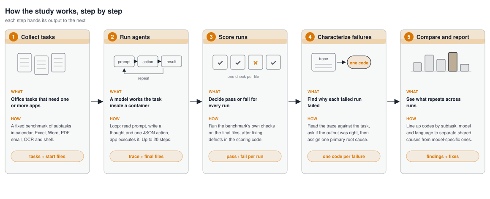

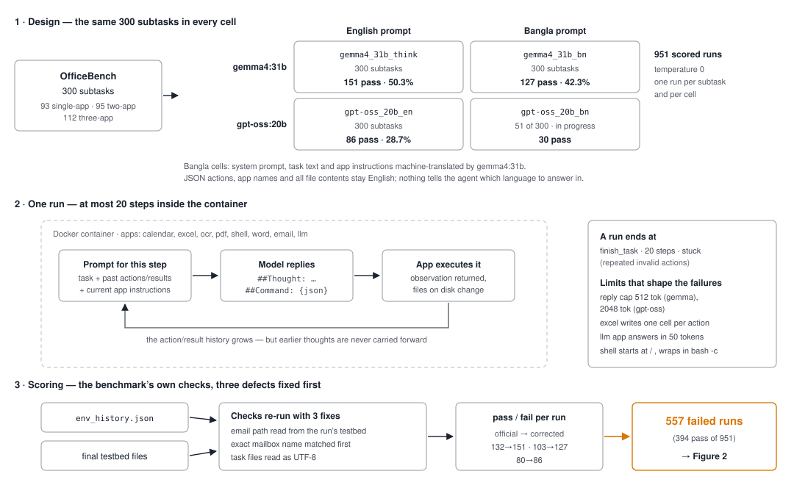

### R.2 Success rate by run and task size

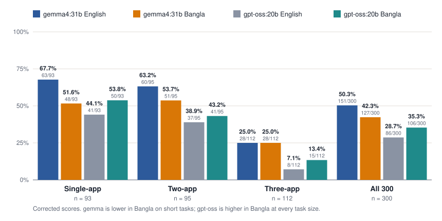

- gemma4:31b passes **50.3%** in English and **42.3%** in Bangla; gpt-oss:20b passes **28.7%** in English and **35.3%** in Bangla.
- **The two models move in opposite directions.** gemma is lower in Bangla (+8.0 pp), gpt-oss is higher in Bangla (-6.7 pp), and the models differ by +14.7 pp (95% interval [7.7, 22.3] pp).
- Every run falls sharply with task size: gemma English from 67.7% on single-app to 25.0% on three-app; gpt-oss English from 44.1% to 7.1%.
- The English–Bangla gap of gemma sits in single-app (+16.1 pp) and two-app (+9.5 pp) tasks; on three-app tasks both languages pass the same 28 of 112.

### R.3 gemma4:31b, English against Bangla, subtask by subtask

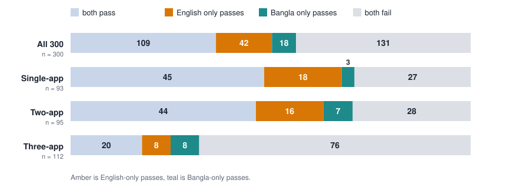

- 42 subtasks pass only in English and 18 only in Bangla. The English-only group is the one analysed case by case in Sections 4–12.
- On three-app tasks the two directions are equal (8 and 8), so there is no net gap even though 16 subtasks change outcome.

### R.4 gpt-oss:20b, English against Bangla, subtask by subtask

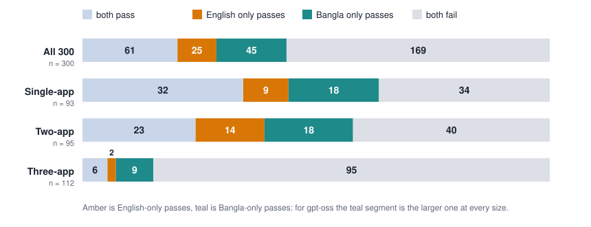

- 25 subtasks pass only in English and **45 only in Bangla**, the opposite balance to gemma. The Bangla-only group is the larger one at every task size (18 against 9 single-app, 18 against 14 two-app, 9 against 2 three-app).
- The Bangla prompt removes much of gpt-oss’s trouble with the benchmark’s action format (Figure 6): invalid actions fall from 1671 to 955, calls to its own built-in tools from 643 to 99, stuck runs from 31 to 14, and finished runs rise from 182 to 222.

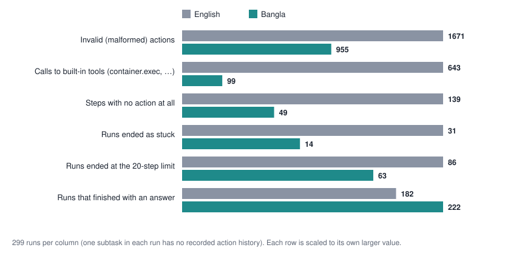

### R.5 Why runs fail

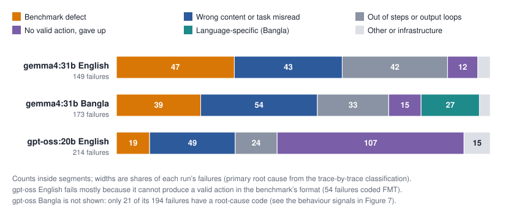

- **Benchmark defects** are the largest single cause for gemma (31.5% of English failures, 22.5% of Bangla) and still 8.9% of gpt-oss English failures.
- **gpt-oss English** fails mostly by not producing a valid action: 107 of 214 failures (50.0%) are coded no valid action or gave up, 54 of them action-format failures.
- **Bangla-specific causes** (answer script, name case, word choice, translation) are 27 of gemma’s 173 Bangla failures (15.6%); the rest also occur in English.
- gpt-oss Bangla has root-cause codes only for the 21 failures among its first 51 subtasks, so it is left out of Figure 7; its 25 EN-pass/BN-fail cases are analysed by hand in Part II.

### R.6 What fails everywhere

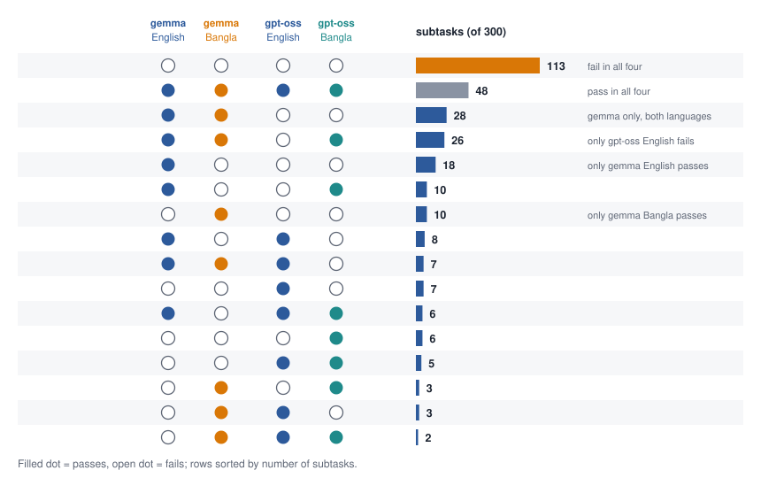

- **113** subtasks fail in all four runs and **48** pass in all four.
- Using the three runs that have root-cause codes for every failure: **119** subtasks fail in all three, **44** of them for the identical coded cause, and a benchmark defect decides at least one of the three runs on **57** subtasks, which makes fixing the benchmark the most direct way to raise every score.

### R.7 Pilot runs

Earlier, smaller runs, taken from the long failure report (not recomputed here: the result files for these runs are padded with fails for subtasks that were never run).

| Run tags | Model | Written reasoning | Subtasks run | Passed |
|:---|:---|:---|---:|---:|
| gemma4_31b_first10, next20, probe, rest, gemmatest | gemma4:31b | no | 91 | 61 |
| qwen2.5-7b_test, batch10 | qwen2.5-7b | no | 12 | 3 |

Writing the reasoning before each action barely helped gemma on single-app tasks (58 against 60 of 87). Seven of the twelve Qwen2.5-7B runs ended stuck after repeated malformed actions.

## 1. Data prepared (pipeline section 1)

Every subtask has one row. Alignment check: **300 of 300 task IDs appear in both runs; none are English-only or Bangla-only.**

| Field | Where it comes from |
|:---|:---|
| dataset, model, task ID, run ID | OfficeBench / gemma4:31b / `task/subtask` (e.g. `1-2/0`) / `gemma4_31b_think`, `gemma4_31b_bn` |
| English and Bangla pass/fail | `analysis/failure_codes_all_runs.json` → `pass.EN`, `pass.BN` (saved as `analysis/fa_rows.json`) |
| Trajectory paths | `tasks/<t>/outputs/<s>/gemma4_31b_{think,bn}/env_history.json` (actions and observations), `llm_history.json` (prompts and thoughts) |
| Final state | `.../gemma4_31b_{think,bn}/testbed/` (files after the run) |
| Task metadata | `tasks/<t>/subtasks/<s>.json` (task text and the evaluation functions) |
| Tool calls, arguments, results, final answer | inside `env_history.json` as (action, observation) pairs |

## 2. Basic outcome (pipeline section 2)

| Setting | n | EN pass | BN pass | Gap (EN−BN) | MELR | PP | **PF** | FP | FF |
|:---|---:|---:|---:|---:|---:|---:|---:|---:|---:|
| Overall | 300 | 151 (50.3%) | 127 (42.3%) | +8.0 pp | 15.9% | 109 | **42** | 18 | 131 |
| Single-app | 93 | 63 (67.7%) | 48 (51.6%) | +16.1 pp | 23.8% | 45 | **18** | 3 | 27 |
| Two-app | 95 | 60 (63.2%) | 51 (53.7%) | +9.5 pp | 15.0% | 44 | **16** | 7 | 28 |
| Three-app | 112 | 28 (25.0%) | 28 (25.0%) | +0.0 pp | 0.0% | 20 | **8** | 8 | 76 |

MELR = (EN − BN) / EN. PP = EN-pass/BN-pass, **PF = EN-pass/BN-fail**, FP = EN-fail/BN-pass, FF = EN-fail/BN-fail. Denominator is the number of aligned subtasks in the row.

**42 subtasks are EN-pass/BN-fail**, 18 are EN-fail/BN-pass. The gap is entirely in short tasks: on three-app tasks both languages pass 28 of 112 (25.0%), on single-app tasks the gap is +16.1 pp.

## 3. Which cases were analysed (pipeline section 3)

| Group | Count | How analysed here |
|:---|---:|:---|
| EN-pass / BN-fail | 42 | **All 42** read trace-against-trace and labelled (Section 4 and Appendix A). |
| EN-fail / BN-fail | 131 | Not re-read. Compared through the earlier per-run root-cause codes for all 131 (Appendix B), as the general-difficulty baseline. |
| EN-pass / BN-pass | 109 | Counted by app size only (stable-success profile, Appendix B). |
| EN-fail / BN-pass | 18 | Not labelled here. The earlier analysis already traced all 18 (7 English traps, 7 shorter Bangla reasoning, 4 other); see `analysis/full_failure_report_pdf.py`, section 6.3. |

## 4. Trace notes (pipeline section 4)

The failure analysis follows one procedure for every failed run (Figure 9 shows it on a real subtask; Figure 10 is the coding scheme).

One note per EN-pass/BN-fail case, with the nine fields the pipeline asks for. The 42 notes are in Appendix A in the pipeline’s field order. Two worked examples show the level of detail.

**3-56/0**

- Task goal: Assign the homework “read book and write essay” in hw1.docx.
- English: Created hw1.docx containing the English sentence.
- Bangla: Created hw1.docx containing the Bangla translation of the sentence.
- First divergence: Step 0: English writes the quoted text, Bangla writes its translated form.
- Final failed or missing action: The literal quoted text in the file.
- Failure type: Wrong tool argument
- Root cause: The quoted homework text was translated with the rest of the task, so the literal to be written was no longer present in the prompt.
- Confound decision: Translation/localization error (high confidence)
- Evidence: In 3-56/0, English wrote “read book and write essay”. In Bangla the agent wrote বই পড়ো এবং প্রবন্ধ লেখো, so the keyword check fails. A protected token was not preserved by the translation.

**1-15/0**

- Task goal: Add one sentence to the end of house_creak.docx.
- English: write_to_file with only the new sentence; the tool appended it (final file = original + sentence).
- Bangla: Read the 12.9k-character story, then tried 14 times to rewrite the whole document plus the sentence; every attempt was cut off.
- First divergence: Step 1: English writes, Bangla reads first.
- Final failed or missing action: Any successful write.
- Failure type: Planning failure
- Root cause: The agent planned to resend the entire document. The write tool is described in both languages only as “write text to a word file” and does not say it appends, so the plan was reasonable; the reply cap then rejected each long action.
- Confound decision: Tool/environment failure (medium confidence)
- Evidence: In 1-15/0, English passed with one short write_to_file (the tool appended). In Bangla, 14 consecutive write_to_file actions carrying the whole story were rejected as “Malformed action!” until step 20. Undocumented append behaviour plus the reply-length cap decided the run.

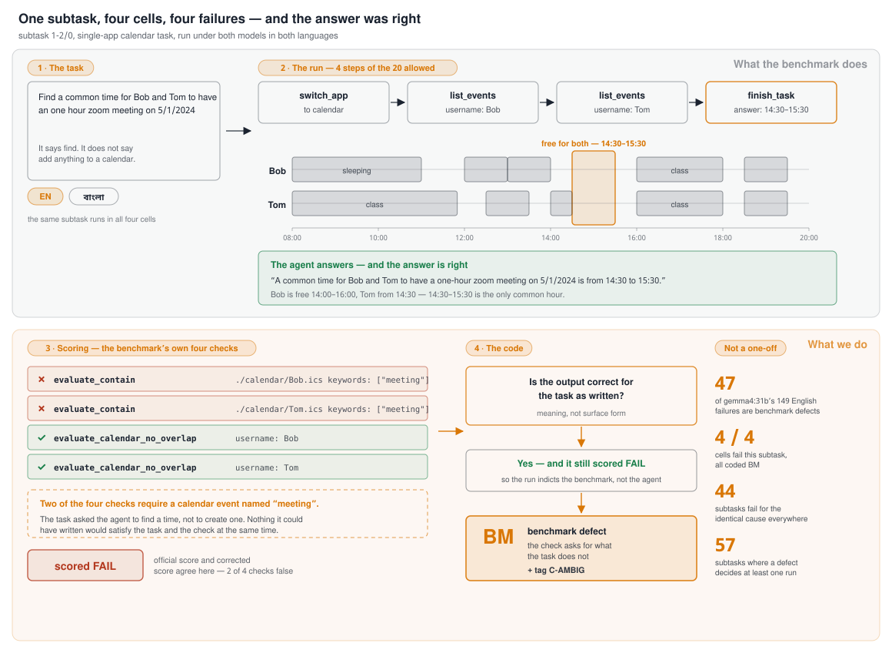

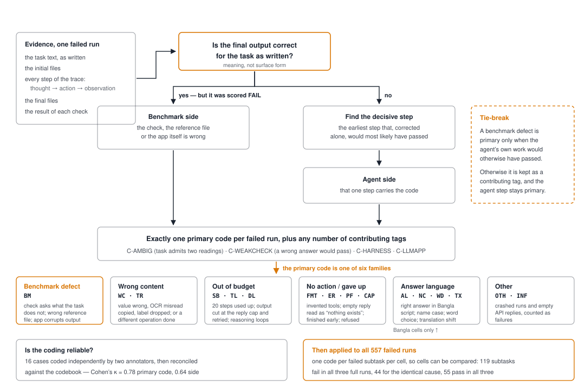

## 5. First failure point (pipeline section 5)

Rule applied: label the earliest upstream point, not the visible final error. For the answer-language cases the earliest point is the final response itself, because every earlier step matches English.

| First failure point | Cases | Share of 42 |
|:---|---:|---:|
| Instruction understanding | 5 | 11.9% |
| Entity or slot grounding | 5 | 11.9% |
| Task constraint preservation | 3 | 7.1% |
| Planning | 5 | 11.9% |
| Tool-argument construction | 4 | 9.5% |
| Tool execution | 2 | 4.8% |
| Result verification | 2 | 4.8% |
| Premature termination | 1 | 2.4% |
| Final response only | 15 | 35.7% |

Reading the table: 15 of 42 cases (35.7%) have **no error before the final response**. Among the other 27, the earliest breaks are tool arguments (4), planning (5), instruction understanding (5) and entity grounding (5).

## 6. Failure type (pipeline section 6)

| Failure type | Cases | Share of 42 |
|:---|---:|---:|
| Understanding failure | 6 | 14.3% |
| Planning failure | 6 | 14.3% |
| Wrong tool argument | 8 | 19.0% |
| Execution/environment failure | 3 | 7.1% |
| Verification failure | 1 | 2.4% |
| Premature abandonment | 1 | 2.4% |
| Output-language mismatch (added) | 15 | 35.7% |
| Reasoning on observed data (added) | 2 | 4.8% |

The special cases listed in the pipeline map as follows: *premature STOP before the final tool call* → no equivalent (no simulated user); *internal ID used as a name* → closest is the lower-cased mailbox name (Wrong tool argument, 3); *changed task constraint* → the dropped column (1-11/0), the filtered roster (2-20/0) and four translation-driven misreadings (Understanding, 6 in all), plus the wrong calendar owner (2-17/0, Wrong tool argument); *compound task partially completed* → 3-15/0 (image skipped) and the two three-app step-budget cases.

## 7. Confound type (pipeline section 7)

| Confound | Cases | Share of 42 |
|:---|---:|---:|
| C1  Genuine Bangla-related agent failure | 6 | 14.3% |
| C3  Translation/localization error | 6 | 14.3% |
| C4  Tool/environment failure | 5 | 11.9% |
| C5  Benchmark/task ambiguity (answer language / weak check) | 15 | 35.7% |
| C6  General model weakness present in both languages | 3 | 7.1% |
| C7  Unclear | 7 | 16.7% |

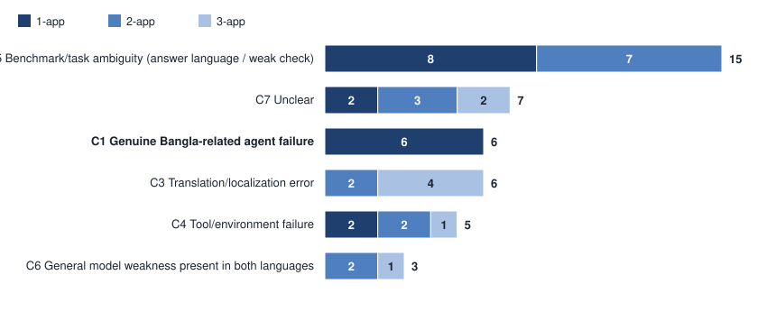

Confidence of the annotator on the confound label: high 19, medium 14, low 9.

By app count:

| Confound | 1-app (n=18) | 2-app (n=16) | 3-app (n=8) |
|:---|---:|---:|---:|
| C1  Genuine Bangla-related agent failure | 6 | 0 | 0 |
| C2  Bangla user-simulator error | 0 | 0 | 0 |
| C3  Translation/localization error | 0 | 2 | 4 |
| C4  Tool/environment failure | 2 | 2 | 1 |
| C5  Benchmark/task ambiguity (answer language / weak check) | 8 | 7 | 0 |
| C6  General model weakness present in both languages | 0 | 2 | 1 |
| C7  Unclear | 2 | 3 | 2 |

## 8. Root-cause decision tree (pipeline section 8)

Each EN-pass/BN-fail case leaves the tree at the first step that fires. Counts of exits:

| Exit step | Cases | Root cause assigned |
|:---|---:|:---|
| Step 0 (added): output already correct, check rejects it | 15 | Output already correct; check is English-only or weak (C5) |
| Step 1: translated task not valid | 6 | Translation/localization error (C3) |
| Step 2: user simulator (not applicable) | 0 | — (no user simulator) |
| Step 3: agent misunderstood / mis-grounded | 8 | Understanding or grounding failure (C1 where mechanism is shown, otherwise C6/C7) |
| Step 4: wrong tool/action | 0 | — (no wrong-tool case found) |
| Step 5: wrong argument | 3 | Wrong tool argument (C1) |
| Step 6: tool/environment | 7 | Tool/environment (C4) or shared cap failure (C6) |
| Step 7: verification / abandonment | 3 | Verification / abandonment (C7) |

No case exits at Step 4: in every EN-pass/BN-fail case the Bangla agent selected an app and action that exists and that English also used or could have used.

## 9. Evidence for each root cause (pipeline section 9)

Each of the 42 cases carries the six required items: English outcome, Bangla outcome, first failure point, the action or message that shows it, why it is not simply a general model failure, and the confound label. They are in Appendix A. The “why not general” item is the *Root cause* line plus the check against the English run; it is explicitly weak for the 3 C6 and 7 C7 cases, which is why they sit outside the lower bound on genuine Bangla effects.

## 10. Counts (pipeline section 10)

Items 1–3 are in Sections 5–7. The remaining items:

| Count | Cases | Share of 42 |
|:---|---:|---:|
| Genuine Bangla-related agent failures (C1), after filtering | 6 | 14.3% |
| Bangla user-simulator-caused (C2) | 0 | 0.0% |
| Translation-caused (C3) | 6 | 14.3% |
| Tool/environment-caused (C4) | 5 | 11.9% |
| Answer-language / weak-check (C5) | 15 | 35.7% |
| General weakness present in both (C6) | 3 | 7.1% |
| Unclear, candidates for genuine failure (C7) | 7 | 16.7% |

Dataset-wise: single dataset. Model-wise: single model. Domain-wise (app count) is in the Section 7 table: 18 single-app, 16 two-app, 8 three-app cases.

The upper bound on genuine Bangla effects is C1 + C7 = 13 cases (31.0% of 42); the lower bound is C1 = 6 (14.3%).

## 11. Statistical analysis (pipeline section 11)

Paired design: same 300 subtasks in both languages. McNemar exact two-sided test on discordant pairs; 95% intervals: Wilson for proportions, paired bootstrap (4000 resamples of subtasks, seed 7) for the gap and MELR. Effect size: Cohen’s *g* = b/(b+c) − 0.5 on discordant pairs (conventions: 0.05 small, 0.15 medium, 0.25 large) and the discordant odds ratio b/c.

| Setting | EN success [95% CI] | BN success [95% CI] | Gap [95% CI, pp] | MELR [95% CI, %] |
|:---|---:|---:|---:|---:|
| Overall | 50.3% [44.7%, 56.0%] | 42.3% [36.9%, 48.0%] | +8.0 pp [3.0, 13.0] | 15.9% [6.6, 25.0] |
| Single-app | 67.7% [57.7%, 76.4%] | 51.6% [41.6%, 61.5%] | +16.1 pp [7.5, 25.8] | 23.8% [11.3, 36.2] |
| Two-app | 63.2% [53.1%, 72.2%] | 53.7% [43.7%, 63.4%] | +9.5 pp [0.0, 18.9] | 15.0% [0.0, 29.2] |
| Three-app | 25.0% [17.9%, 33.8%] | 25.0% [17.9%, 33.8%] | +0.0 pp [-7.1, 7.1] | 0.0% [-34.6, 25.0] |

| Setting | b / c (PF / FP) | McNemar p | Holm-adjusted p | Cohen’s g | Odds b/c |
|:---|---:|---:|---:|---:|---:|
| 1-app | 18 / 3 | 0.001 | 0.004 | 0.36 | 6.0 |
| 2-app | 16 / 7 | 0.093 | 0.186 | 0.20 | 2.3 |
| 3-app | 8 / 8 | 1.000 | 1.000 | 0.00 | 1.0 |
| **Overall (not in Holm family)** | 42 / 18 | 0.003 | — | 0.20 | 2.3 |

Holm is applied across the three app-count subgroup tests. The overall test is a single pre-specified comparison and is reported unadjusted. The overall gap is +8.0 pp with a 95% interval of [3.0, 13.0] pp (MELR 15.9%, interval [6.6, 25.0]%), g = 0.20 (between the medium and large conventions). The single-app gap is significant after Holm (adjusted p = 0.004); the two-app gap is not (adjusted p = 0.186); the three-app gap is exactly zero.

### Sensitivity analysis

Scenarios remove confounded subtasks from the whole sample (both languages), or credit the Bangla run for answers that are right but written in Bangla script. S2 equals S0 because there is no user simulator.

| Scenario | n | EN | BN | Gap | Gap 95% CI (pp) | MELR | PF / FP | McNemar p |
|:---|---:|---:|---:|---:|---:|---:|---:|---:|
| S0  All 300 subtasks (as scored) | 300 | 50.3% | 42.3% | +8.0 pp | [3.0, 13.0] | 15.9% | 42 / 18 | 0.003 |
| S1  Drop translation-confounded subtasks (C3) | 294 | 49.3% | 43.2% | +6.1 pp | [1.4, 11.2] | 12.4% | 36 / 18 | 0.020 |
| S2  Drop user-simulator-confounded subtasks (C2) | 300 | 50.3% | 42.3% | +8.0 pp | [3.0, 13.0] | 15.9% | 42 / 18 | 0.003 |
| S3  Drop tool/environment-confounded subtasks (C4) | 295 | 49.5% | 43.1% | +6.4 pp | [1.4, 11.5] | 13.0% | 37 / 18 | 0.014 |
| S4  Drop answer-language / weak-check subtasks (C5) | 285 | 47.7% | 44.6% | +3.2 pp | [-1.4, 7.7] | 6.6% | 27 / 18 | 0.233 |
| S5  Drop C3 + C4 + C5 | 274 | 45.6% | 46.4% | -0.7 pp | [-4.7, 3.6] | -1.6% | 16 / 18 | 0.864 |
| S6  Drop C3 + C4 + C5 + C6 (leave C1 and C7) | 271 | 45.0% | 46.9% | -1.8 pp | [-5.9, 2.2] | -4.1% | 13 / 18 | 0.473 |
| S7  Credit Bangla answers that are correct but in Bangla script (C5 → BN pass) | 300 | 50.3% | 47.3% | +3.0 pp | [-1.3, 7.3] | 6.0% | 27 / 18 | 0.233 |
| S8  S7, and drop C3 + C4 | 289 | 48.4% | 49.1% | -0.7 pp | [-4.5, 3.1] | -1.4% | 16 / 18 | 0.864 |
| S9  S5 made symmetric: also drop the 7 EN-fail/BN-pass subtasks that the earlier analysis traced to English environment traps | 267 | 46.8% | 44.9% | +1.9 pp | [-1.9, 5.6] | 4.0% | 16 / 11 | 0.442 |

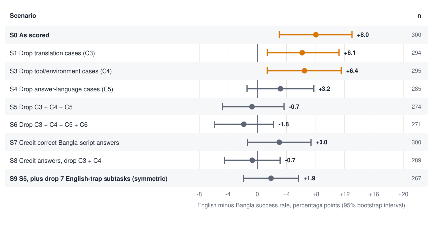

How to read this. Removing the 26 C3, C4 and C5 subtasks (S5) takes the gap from +8.0 pp to -0.7 pp (p = 0.864); crediting the Bangla answers that are correct in content (S7) takes it to +3.0 pp (p = 0.233). Two cautions apply.

1. **S1–S6 are asymmetric.** Every confounded subtask identified in this report is an EN-pass/BN-fail case, so dropping them lowers the gap mechanically. The EN-fail/BN-pass side was not audited with the same care. S9 applies the same treatment to the 7 subtasks that the earlier analysis (section 6.3 of the long report) traced to English environment traps: the gap is +1.9 pp (95% interval [-1.9, 5.6] pp, p = 0.442), and the interval includes zero. Four more EN-fail/BN-pass subtasks were attributed to translation helping the Bangla run; their IDs are not recorded, so they could not be removed, and the true symmetric gap is a little smaller still.

2. **S7 is conservative.** Three further Bangla answers are correct in content but sit in subtasks that English fails (1-22/2, 1-22/3, 1-22/4), so they are not in the EN-pass/BN-fail set and S7 does not credit them.

What can be said: the measured overall gap is of the size that the identified confounds (checker language, translation, harness) can account for; what is left after filtering is 6 C1 cases, 3 C6 cases and 7 C7 cases, too few to establish a Bangla-specific cost with one run per cell. That is a statement about this evidence, not proof that Bangla has no cost.

## 12. Findings (pipeline section 12)

Each finding gives observation, evidence, root cause and boundary. These findings are for gemma4:31b; the gpt-oss findings are in Section II.11.

**F1. The largest single driver of the English–Bangla gap is that the checker only reads English.** We find that answer-language mismatch accounts for 15 of 42 EN-pass/BN-fail cases (35.7%). In every one the Bangla answer has the same content as the English answer but is written the answer in Bangla script or Bangla digits (e.g. 1-10/0 “৪০” for 40; 2-31/0 “$২০,০০০” for $20,000), and the check searches for an ASCII keyword. Nothing in the task or the tool text names an answer language, so the first failure point is the final response. Crediting these answers moves the gap from +8.0 pp to +3.0 pp. *Boundary:* the claim concerns the benchmark’s scoring, not the agent’s capability; one of the 15 (1-2/4) is also a weak English pass, so its true English status is uncertain.

**F2. A further 6 cases (14.3%) trace to the translated prompt itself.** The translation changed the task in five ways: it translated a quoted literal (3-56/0 wrote the homework sentence in Bangla), turned “sum” into a verb that also means “add” (3-68/0 wrote two totals, not 1494.97), presented files to be created as existing ones through the definite marker (2-38/2, 3-17/0), read “make a post reward.jpg” as “make a post *for* reward.jpg” (3-55/0), and applied “except sleeping” to the nap as well (2-40/2). These are first-failure points in instruction understanding or constraint preservation, upstream of any agent error. *Boundary:* the Bangla task was machine-translated by the same model family; a human-checked translation could remove them, and would be the cleanest test of how many remain.

**F3. Cases that look like genuine Bangla agent failures are few and share one mechanism: rendering an English value from a Bangla prompt.** After filtering F1, F2 and the harness cases, 6 cases (14.3%) remain that we label genuine. Three change a literal English word or format when writing it (“Trip” for “travelling”, “curd” for “yogurt”, “08:00 AM” for “8:00”) and three look up a mailbox with a lower-cased name (1-20/3, 1-21/1, 1-21/2), because a name written only in Bangla script has no letter case and the lookup is case-sensitive. The first failure point is tool-argument construction or entity grounding, not understanding. *Boundary:* each is one run; 7 further cases (C7) have no visible mechanism and could be genuine.

**F4. Harness and tool behaviour decide 5 cases (11.9%), independent of language.** Two runs ended on empty model replies (2-1/0, 2-1/1); 3-9/0 lost two steps to an apostrophe that breaks the shell-invoked llm app; and in 1-15/0 and 1-15/1 the Bangla agent resent the whole document because the word tool is described only as “write text to a word file” (it appends), then every long action was cut off by the reply cap. The English runs passed by taking the short route in the same environment. *Boundary:* a Bangla-triggered empty generation cannot be ruled out for the two empty-reply runs, and the Bangla agent’s plan was a reasonable reading of an under-specified tool.

**F5. The gap is a short-task effect.** It is +16.1 pp on single-app tasks (Holm-adjusted p = 0.004), +9.5 pp on two-app tasks (adjusted p = 0.186) and +0.0 pp on three-app tasks, where both languages pass only 25.0%. Three-app tasks fail for the same reasons in both languages (step budget, cut-off writes, benchmark defects), which hides any language effect. 15 of the 15 C5 cases are single- or two-app, because question-answering tasks are short. *Boundary:* the three-app result is a statement about task difficulty, not evidence that Bangla is as good as English on hard tasks.

**F6. Most Bangla failures are not Bangla failures.** Of the 131 EN-fail/BN-fail subtasks, 94 (71.8%) carry the same earlier root-cause code in both languages (Appendix B), and the dominant causes in the two groups differ: the EN-pass/BN-fail set is dominated by output-language and translation effects, the both-fail set by benchmark defects, wrong content and step budget. *Boundary:* the both-fail codes come from the earlier per-run classification, not from the case notes in this report.

**Not claimed.** The data do not support “Bangla agents reason worse”: no EN-pass/BN-fail case has a wrong number, date or path that the trace ties to reading Bangla. The 2-32/1 and 3-87/0 errors (wrong comparison, miscount) occur on identical OCR input and may be sampling variation at one run per cell.

## 13. Paper outputs (pipeline section 13)

| # | Output | Status | Where |
|---:|:---|:---|:---|
| 1 | Overall English vs Bangla success table | Done | Section 2, Section 11 |
| 2 | MELR by dataset and model | Done for the one available dataset/model; by app count | Section 2, Section 11 |
| 3 | Paired outcome table | Done | Section 2 (PP / PF / FP / FF) |
| 4 | Failure-type distribution for PF | Done | Section 6 |
| 5 | First-failure-point distribution | Done | Section 5 |
| 6 | Confound filtering table | Done | Section 7, Section 10 |
| 7 | Before/after confound-filtered results | Done | Section 11, sensitivity table |
| 8 | Two or three short case studies | Drafted below (Section 15) | Section 15 |
| 9 | Appendix with annotation rules and long trajectories | Rules and 42 notes done; long trajectories are in `analysis/fa_pairs.txt` | Appendix A, `analysis/codebook.md` |

## 14. Quality-control checklist (pipeline section 14)

| Check | Status | Note |
|:---|:---|:---|
| Every task ID aligned between English and Bangla | Pass | 300 of 300 aligned (Section 1). |
| Every metric has a denominator | Pass | Stated in each table header or caption. |
| EN-pass/BN-fail separated from both-fail | Pass | Sections 2, 3 and Appendix B. |
| Translation errors not counted as genuine Bangla failures | Pass | C3 is its own class (6 cases). |
| User-simulator errors counted separately | Not applicable | No user simulator in OfficeBench. |
| Tool/environment failures counted separately | Pass | C4 is its own class (5 cases). |
| A second reviewer checks a subset | **Not done** | Single annotator. A 12-case blind subset is listed below; `analysis/agreement.py` computes κ from two label CSVs of the same shape as `labels_A.csv` / `labels_B.csv`. |
| Disagreements adjudicated | **Not done** | Depends on the previous item. |
| Case studies match the quantitative patterns | Pass | Section 15 cases are drawn from the two largest classes (C5, C3) plus one C4. |
| Strong claims only after confound filtering | Pass | F1–F6 each state the filtered count and a boundary. |

Blind subset for the second reviewer (random, seed 11, 12 of 42): `1-11/0`, `1-15/0`, `1-15/1`, `1-20/3`, `2-33/1`, `2-34/1`, `2-36/1`, `2-38/2`, `3-15/0`, `3-55/0`, `3-68/0`, `3-87/0`.

Other limits: one run per cell at temperature 0, so run-to-run variation is not measured; the English and Bangla runs are scored by the same corrected checker; the gpt-oss Bangla failures beyond the first 51 subtasks are not root-cause coded; confidence is low on 9 of 42 notes.

## 15. Case studies

**3-68/0 — A translation that changed the operation.** In 3-68/0, English wrote 1494.97. The Bangla task says “সমস্ত খরচ costs.xlsx ফাইলে যোগ করুন”, and the agent wrote 104.98 and 1389.99 separately; 104.98 + 1389.99 = 1494.97, the value the check requires.

*Root cause:* “sum all the costs” became “add all costs to costs.xlsx” (a verb that also means add/append), so no sum was computed. *Label:* C3, Translation/localization error, first failure point “Instruction understanding”.

**1-10/0 — A correct answer the checker cannot read.** In 1-10/0, English passed with “The highest score of midterm 1 is 100, the lowest score is 60, and the difference is 40.”. In Bangla the agent reached the same content but wrote “মিডটার্ম ১-এর সর্বোচ্চ স্কোর ১০০ এবং সর্বনিম্ন স্কোর ৬০। তাদের মধ্যে পার্থক্য হলো ৪০।”, so the keyword “40” is absent and the check fails.

*Root cause:* Nothing in the task or the tool text says which language to answer in; the Bangla agent answers in Bangla script and digits and the check searches for the ASCII keyword “40”. *Label:* C5, Benchmark/task ambiguity (answer language / weak check), first failure point “Final response only”.

**1-15/0 — A tool that is under-described.** In 1-15/0, English passed with one short write_to_file (the tool appended). In Bangla, 14 consecutive write_to_file actions carrying the whole story were rejected as “Malformed action!” until step 20. Undocumented append behaviour plus the reply-length cap decided the run.

*Root cause:* The agent planned to resend the entire document. The write tool is described in both languages only as “write text to a word file” and does not say it appends, so the plan was reasonable; the reply cap then rejected each long action. *Label:* C4, Tool/environment failure, first failure point “Planning”.

## Part II. The pipeline applied to gpt-oss:20b

The gpt-oss Bangla run finished after the first draft of this report: **300 of 300 subtasks**. It was scored with `analysis/fa_rescore.py`, which applies the same three repairs as the other runs and reproduces the existing corrected scores exactly for gemma English (151), gemma Bangla (127), gpt-oss English (86) and the first 51 gpt-oss Bangla subtasks (30), with zero mismatches. Sections II.1–II.10 follow the same pipeline steps as Sections 1–14 for gpt-oss.

### II.1 Data and alignment (pipeline section 1)

300 of 300 task IDs are present in both gpt-oss runs. Action histories are recorded for 299 runs in each language; one subtask per run has none (2-40/3 in English, 3-46/0 in Bangla) but still has its output files, so it is scored from the files. Fields and paths are as in Section 1 with the run tags `gpt-oss_20b_en` and `gpt-oss_20b_bn`.

### II.2 Basic outcome (pipeline section 2)

| Setting | n | EN pass | BN pass | Gap (EN−BN) | MELR | PP | **PF** | **FP** | FF |
|:---|---:|---:|---:|---:|---:|---:|---:|---:|---:|
| Overall | 300 | 86 (28.7%) | 106 (35.3%) | -6.7 pp | -23.3% | 61 | **25** | **45** | 169 |
| Single-app | 93 | 41 (44.1%) | 50 (53.8%) | -9.7 pp | -22.0% | 32 | **9** | **18** | 34 |
| Two-app | 95 | 37 (38.9%) | 41 (43.2%) | -4.2 pp | -10.8% | 23 | **14** | **18** | 40 |
| Three-app | 112 | 8 (7.1%) | 15 (13.4%) | -6.2 pp | -87.5% | 6 | **2** | **9** | 95 |

Same definitions as Section 2. **The gap is negative: gpt-oss passes more subtasks in Bangla than in English** (106 against 86), and the Bangla advantage holds at every task size. The paired outcome is 25 EN-pass/BN-fail against 45 EN-fail/BN-pass.

Figure 5 (Section R.4) shows the paired outcome as bars.

### II.3 Statistics (pipeline section 11)

| Setting | EN success [95% CI] | BN success [95% CI] | Gap [95% CI, pp] | MELR [95% CI, %] |
|:---|---:|---:|---:|---:|
| Overall | 28.7% [23.8%, 34.0%] | 35.3% [30.1%, 40.9%] | -6.7 pp [-12.0, -1.3] | -23.3% [-46.3, -3.6] |
| Single-app | 44.1% [34.4%, 54.2%] | 53.8% [43.7%, 63.5%] | -9.7 pp [-20.4, 1.1] | -22.0% [-56.2, 2.1] |
| Two-app | 38.9% [29.8%, 49.0%] | 43.2% [33.7%, 53.2%] | -4.2 pp [-15.8, 7.4] | -10.8% [-50.0, 17.4] |
| Three-app | 7.1% [3.7%, 13.5%] | 13.4% [8.3%, 20.9%] | -6.2 pp [-12.5, -0.9] | -87.5% [-300.0, -9.1] |

| Setting | b / c (PF / FP) | McNemar p | Holm-adjusted p | Cohen’s g | Odds b/c |
|:---|---:|---:|---:|---:|---:|
| 1-app | 9 / 18 | 0.122 | 0.244 | -0.17 | 0.50 |
| 2-app | 14 / 18 | 0.597 | 0.597 | -0.06 | 0.78 |
| 3-app | 2 / 9 | 0.065 | 0.196 | -0.32 | 0.22 |
| **Overall (not in Holm family)** | 25 / 45 | 0.022 | — | -0.14 | 0.56 |

The overall Bangla advantage is -6.7 pp (95% interval [-12.0, -1.3] pp), McNemar p = 0.022, g = -0.14 (negative sign: Bangla ahead). After Holm correction across the three task sizes the subgroup tests give adjusted p = 0.244, 0.597 and 0.196, so the direction is consistent but no single size is significant on its own.

**The two models move in opposite directions.** Taking the English-minus-Bangla gap for gemma (+8.0 pp) and for gpt-oss (-6.7 pp) on the same 300 subtasks, their difference is **+14.7 pp** (95% bootstrap interval [7.7, 22.3] pp), which excludes zero.

### II.4 Cases analysed (pipeline section 3)

| Group | Count | How analysed here |
|:---|---:|:---|
| EN-pass / BN-fail | 25 | **All 25** traced and labelled (Appendix D). |
| EN-fail / BN-pass | 45 | The largest discordant group, so it is not skipped: English run’s earlier root-cause code and behaviour signals for all 45 (Section II.9). |
| EN-pass / BN-pass | 61 | Counted only. |
| EN-fail / BN-fail | 169 | Counted only. The Bangla run’s failures are not root-cause coded beyond the first 51 subtasks. |

### II.5 Trace notes (pipeline section 4)

One note per EN-pass/BN-fail case, in Appendix D. A worked example:

- Task goal: Read grades from the transcript and write a grade report (report.docx).
- English: OCR, then wrote report.docx directly (14 steps).
- Bangla: OCR, then four llm-app calls that each returned an empty string, then got_stuck.
- First divergence: Step 7: English writes the report, Bangla calls the llm app.
- Final failed or missing action: report.docx.
- Failure type: Execution/environment failure
- Root cause: The llm app returned nothing: it calls the same reasoning model with a 50-token answer limit, which the hidden reasoning uses up. English avoided the app.
- Confound decision: Tool/environment failure (medium confidence)
- Evidence: In 2-36/0, English wrote the report without the llm app. In Bangla all 4 complete_text calls returned an empty string and the run ended with got_stuck.

### II.6 First failure point (pipeline section 5)

| First failure point | Cases | Share of 25 |
|:---|---:|---:|
| Instruction understanding | 4 | 16.0% |
| Entity or slot grounding | 7 | 28.0% |
| Task constraint preservation | 1 | 4.0% |
| Planning | 1 | 4.0% |
| Tool-argument construction | 1 | 4.0% |
| Tool execution | 2 | 8.0% |
| Result verification | 4 | 16.0% |
| Premature termination | 2 | 8.0% |
| Final response only | 3 | 12.0% |

### II.7 Failure type (pipeline section 6)

| Failure type | Cases | Share of 25 |
|:---|---:|---:|
| Understanding failure | 6 | 24.0% |
| Planning failure | 1 | 4.0% |
| Wrong tool argument | 7 | 28.0% |
| Execution/environment failure | 2 | 8.0% |
| Premature abandonment | 2 | 8.0% |
| Output-language mismatch (added) | 3 | 12.0% |
| Reasoning on observed data (added) | 4 | 16.0% |

### II.8 Confound type and root-cause exits (pipeline sections 7–8)

| Confound | Cases | Share of 25 |
|:---|---:|---:|
| C1  Genuine Bangla-related agent failure | 7 | 28.0% |
| C4  Tool/environment failure | 2 | 8.0% |
| C5  Benchmark/task ambiguity (answer language / weak check) | 6 | 24.0% |
| C6  General model weakness present in both languages | 1 | 4.0% |
| C7  Unclear | 9 | 36.0% |

Confidence of the annotator: high 5, medium 10, low 10.

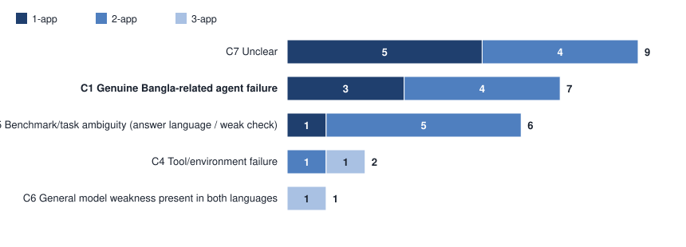

| Exit step | Cases |
|:---|---:|
| Step 0 (added): output already correct, check rejects it | 6 |
| Step 1: translated task not valid | 0 |
| Step 2: user simulator (not applicable) | 0 |
| Step 3: agent misunderstood / mis-grounded | 9 |
| Step 4: wrong tool/action | 0 |
| Step 5: wrong argument | 1 |
| Step 6: tool/environment | 3 |
| Step 7: verification / abandonment | 6 |

Observations:

- **The name-case failure replicates across models.** 6 of the 25 cases are lookups with a lower-cased name (“bob”) that returns nothing, in the email and calendar apps. The same mechanism produced 3 of the gemma genuine cases; the two models fail on the same two subtasks (1-21/1 and 1-21/2). It is the one Bangla-specific agent mechanism seen in both.
- **Answer-language failures are rarer than in gemma.** Only 4 of the 25 cases have an answer in Bangla script (1-12/0, 1-21/2, 2-32/0, 2-33/1) and 2 of them are C5 language cases, against 15 of 42 for gemma; gpt-oss reasons in English and mostly answers in English. The other C5 cases are checker mismatches: a required verbatim sentence (1-19/4), an address the task does not ask for (2-2/0), a file the task does not name (2-26/0) and a keyword that appears only through the subject wording (2-43/1).
- **The llm app returns empty strings for gpt-oss** (2-36/0, 3-89/0): all 14 calls in those two Bangla runs came back empty, because the app calls the same reasoning model with a 50-token answer limit. This is a tool failure that the English runs avoided by not using the app.
- **9 of 25 cases (36.0%) are unclear:** wrong comparisons or missing outputs on identical inputs, with nothing in the trace tied to Bangla.

### II.9 Why gpt-oss does better in Bangla

The 45 subtasks that Bangla passes and English fails are the larger group, so the pipeline asks for their cause.

| English run’s root-cause code | Subtasks | Share of 45 |
|:---|---:|---:|
| FMT  Action format | 19 | 42.2% |
| WC  Wrong content | 6 | 13.3% |
| PF  Premature finish | 6 | 13.3% |
| OTH  Other | 3 | 6.7% |
| TR  Task read differently | 3 | 6.7% |
| SB  Out of steps | 2 | 4.4% |
| BM  Benchmark defect | 2 | 4.4% |
| CAP  Capability claim | 2 | 4.4% |
| ER  Empty result, gave up | 2 | 4.4% |

- **19 of 45 (42.2%)** of these English failures are coded *action format* (could not produce a valid action), the largest single code.
- In **all 45** of the English runs there is at least one malformed action; they contain **127** calls to the model’s built-in tools (container.exec, repo_browser, …) against **2** in the same subtasks in Bangla, and 12 of them ended as stuck.
- Across all runs, the Bangla prompt cut gpt-oss’s invalid actions from 1671 to 955, built-in tool calls from 643 to 99, and stuck runs from 31 to 14 (Figure 6).
- 36 of the 45 subtasks are also passed by gemma in English, so they are not unusually hard.

Figure 6 (Section R.4) shows these signals for all runs.

*Reading:* the Bangla advantage of gpt-oss comes with a large reduction in English-specific format failures, not with better handling of the content. The Bangla prompt is in a different script from the benchmark’s English action format, and the model falls back less often on its own tool-calling habit. This is consistent with the pattern but not proven by it: one run per cell, and the signals are counted automatically, not read case by case.

### II.10 Sensitivity analysis (pipeline section 11)

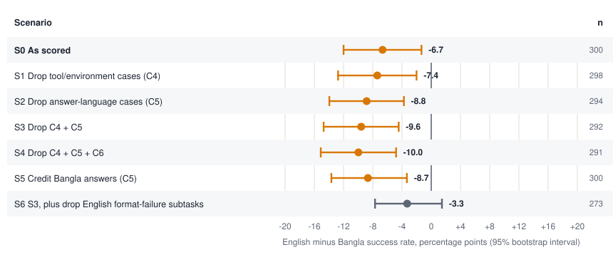

| Scenario | n | EN | BN | Gap | Gap 95% CI (pp) | MELR | PF / FP | McNemar p |
|:---|---:|---:|---:|---:|---:|---:|---:|---:|
| S0  All 300 subtasks (as scored) | 300 | 28.7% | 35.3% | -6.7 pp | [-12.0, -1.3] | -23.3% | 25 / 45 | 0.022 |
| S1  Drop tool/environment cases (C4) | 298 | 28.2% | 35.6% | -7.4 pp | [-12.8, -2.0] | -26.2% | 23 / 45 | 0.010 |
| S2  Drop answer-language / weak-check cases (C5) | 294 | 27.2% | 36.1% | -8.8 pp | [-13.9, -3.7] | -32.5% | 19 / 45 | 0.002 |
| S3  Drop C4 + C5 | 292 | 26.7% | 36.3% | -9.6 pp | [-14.7, -4.5] | -35.9% | 17 / 45 | <0.001 |
| S4  Drop C4 + C5 + C6 | 291 | 26.5% | 36.4% | -10.0 pp | [-15.1, -4.8] | -37.7% | 16 / 45 | <0.001 |
| S5  Credit Bangla answers that fail only on the check (C5 → BN pass) | 300 | 28.7% | 37.3% | -8.7 pp | [-13.7, -3.3] | -30.2% | 19 / 45 | 0.002 |
| S6  S3 made symmetric: also drop the 19 EN-fail/BN-pass subtasks where English failed on action format | 273 | 28.6% | 31.9% | -3.3 pp | [-7.7, 1.5] | -11.5% | 17 / 26 | 0.222 |

S1–S4 remove only English-pass/BN-fail cases, so the Bangla advantage grows by construction (S3: -9.6 pp). S6 treats the other side the same way and also removes the English-fail/BN-pass subtasks where English failed on the action format: the gap falls to -3.3 pp (95% interval [-7.7, 1.5] pp, p = 0.222) and the interval includes zero. The Bangla advantage of gpt-oss therefore rests largely on those English action-format failures, not on the other subtasks.

### II.11 Findings for gpt-oss (pipeline section 12)

**G1. gpt-oss is better in Bangla, gemma is worse; the models differ by +14.7 pp (interval [7.7, 22.3] pp).** We find 106 of 300 passes in Bangla against 86 in English for gpt-oss (-6.7 pp; McNemar p = 0.022), consistent at all three task sizes. *Boundary:* one run per cell; the effect is not significant within any single task size after Holm correction.

**G2. The Bangla advantage of gpt-oss tracks a drop in English-specific format failures.** 19 of the 45 Bangla-only passes are English runs coded action-format failures, every one of the 45 English runs had invalid actions, and the Bangla prompt cut built-in-tool fallbacks from 643 to 99 across all runs. *Boundary:* automatic counts and one run per cell; it shows association, not that the prompt language is the cause.

**G3. Of the 25 gpt-oss EN-pass/BN-fail cases, 7 (28.0%) are genuine Bangla agent failures and 6 of those are one mechanism.** The 7 C1 cases are 6 lower-cased name lookups and one changed word (“Trip” for “travelling”), both seen in gemma. Another 6 (24.0%) are checker or answer-language artefacts (C5), 2 (8.0%) are tool failures (C4) and 9 (36.0%) are unclear (C7). *Boundary:* single annotator, no second review.

**G4. Name case is the one genuine Bangla mechanism in both models.** Names written only in Bangla script have no letter case; the agent writes them in lower case for case-sensitive lookups of mailboxes and calendars, the lookup returns nothing, and the run ends. It accounts for 3 gemma cases (1-20/3, 1-21/1, 1-21/2) and 6 gpt-oss cases (1-21/1, 1-21/2, 2-39/0, 2-39/1, 2-39/3, 2-40/1). A case-insensitive lookup in the tools, or the Latin spelling of names in the prompt, would likely remove them.

**G5. For gpt-oss, the llm app is a separate failure source.** It returned empty strings in every call of two Bangla runs (2-36/0, 3-89/0) and is a known harness problem for a reasoning model with a 50-token limit.

### II.12 Quality control for Part II (pipeline section 14)

| Check | Status | Note |
|:---|:---|:---|
| Every task ID aligned | Pass | 300 of 300. |
| Every metric has a denominator | Pass | Stated in each table. |
| EN-pass/BN-fail separated from both-fail | Pass | Section II.4. |
| Confound classes counted separately | Pass | Section II.8. |
| Scores reproducible | Pass | `fa_rescore.py --validate` reproduces 151 / 127 / 86 / 30-of-51 with zero mismatches. |
| A second reviewer checks a subset | **Not done** | Blind subset (random, seed 13, 10 of 25): `1-18/1`, `1-19/4`, `1-21/1`, `1-21/2`, `2-2/0`, `2-39/0`, `2-39/1`, `2-39/3`, `2-40/1`, `2-43/1`. |
| EN-fail/BN-fail causes for the Bangla run | **Not coded** | Only the first 51 subtasks have root-cause codes; behaviour signals are used instead. |


## Appendix A. Trace notes for all 42 EN-pass/BN-fail cases

Ordered by task ID. Fields follow pipeline section 4. *Type* is the Section 6 label; *Confound* is Section 7 with annotator confidence.

### 1-1/4  ·  C1  ·  1-app

- **Task goal:** Add a calendar event for Bob’s trip to Florida, 6/19–6/23.
- **English:** create_event summary “Travelling to Florida”, correct dates.
- **Bangla:** create_event summary “Trip to Florida”, correct dates.
- **First divergence:** Step 1: the event summary.
- **Final failed / missing action:** None missing; the event exists but its name lacks the keyword “travel”.
- **First failure point:** Tool-argument construction  ·  **Type:** Wrong tool argument
- **Root cause:** A Bangla word for “travelling” was rendered back into English as a different word (“Trip”); the check matches the literal keyword.
- **Confound:** Genuine Bangla-related agent failure (medium)  ·  **Earlier code:** WD (Word choice)
- **Evidence:** In 1-1/4, English passed by calling create_event with summary “Travelling to Florida”. In Bangla the same call used “Trip to Florida”, so the check for “travel” fails although dates and user are correct.

### 1-2/3  ·  C5  ·  1-app

- **Task goal:** Who gets up earlier? Bob or Tom
- **English:** Answer: “Tom”
- **Bangla:** Answer: “টম আগে ঘুম থেকে ওঠে।”
- **First divergence:** Step 0: Bangla starts in the shell and email apps before reading the calendars.
- **Final failed / missing action:** None; the content is right, the script is not.
- **First failure point:** Final response only  ·  **Type:** Output-language mismatch (added)
- **Root cause:** Nothing in the task or the tool text says which language to answer in; the Bangla agent answers in Bangla script and digits and the check searches for the ASCII keyword “Tom”.
- **Confound:** Benchmark/task ambiguity (answer language / weak check) (high)  ·  **Earlier code:** AL (Answer language)
- **Evidence:** In 1-2/3, English passed with “Tom”. In Bangla the agent reached the same content but wrote “টম আগে ঘুম থেকে ওঠে।”, so the keyword “Tom” is absent and the check fails.

### 1-2/4  ·  C5  ·  1-app

- **Task goal:** Who has more commitments on 5/1/2024?
- **English:** Answer: “Both Tom and Bob have the same number of commitments (5) on 5/1/2024.”
- **Bangla:** Answer: “৫/১/২০২৪ তারিখে বব এবং টম উভয়েরই সমান সংখ্যক (৫টি) প্রতিশ্রুতি বা ইভেন্ট রয়েছে।”
- **First divergence:** Final answer step: the answer is written in a different script.
- **Final failed / missing action:** None; the content is right, the script is not.
- **First failure point:** Final response only  ·  **Type:** Output-language mismatch (added)
- **Root cause:** Nothing in the task or the tool text says which language to answer in; the Bangla agent answers in Bangla script and digits and the check searches for the ASCII keyword “Tom”.
- **Confound:** Benchmark/task ambiguity (answer language / weak check) (high)  ·  **Earlier code:** AL (Answer language)
- **Evidence:** In 1-2/4, English passed with “Both Tom and Bob have the same number of commitments (5) on 5/1/2024.”. In Bangla the agent reached the same content but wrote “৫/১/২০২৪ তারিখে বব এবং টম উভয়েরই সমান সংখ্যক (৫টি) প্রতিশ্রুতি বা ইভেন্ট রয়েছে।”, so the keyword “Tom” is absent and the check fails. The English pass is itself weak: its answer says both have 5, and the check expects “Tom”, which appears only because the sentence names both men (C-WEAKCHECK). Neither answer is right by the check’s intent.

### 1-4/1  ·  C1  ·  1-app

- **Task goal:** Add two yogurt to the shopping-list spreadsheet.
- **English:** set_cell row 5 col 1 = “yogurt”, col 2 = 2.
- **Bangla:** set_cell row 5 col 1 = “curd”, col 2 = 2.
- **First divergence:** Step 4: the item name written.
- **Final failed / missing action:** None; the row exists with the wrong word.
- **First failure point:** Tool-argument construction  ·  **Type:** Wrong tool argument
- **Root cause:** Bangla word for yogurt rendered into English as “curd” (a different English word); the check expects “yogurt”.
- **Confound:** Genuine Bangla-related agent failure (medium)  ·  **Earlier code:** WD (Word choice)
- **Evidence:** In 1-4/1, English wrote “yogurt” in A5. In Bangla the agent wrote “curd” in A5, so the cell-value check fails; row, column and quantity are correct.

### 1-6/2  ·  C1  ·  1-app

- **Task goal:** Write 10-minute meeting start times from 8:00 under a new “Meeting” header.
- **English:** Header “Meeting”, then “8:00”, “8:10” … “8:40”.
- **Bangla:** Same header, then “08:00 AM” … “08:40 AM”, then five unrequested calendar events on Alice’s calendar.
- **First divergence:** Step 5: the first time value.
- **Final failed / missing action:** None; values written in a different format.
- **First failure point:** Tool-argument construction  ·  **Type:** Wrong tool argument
- **Root cause:** Time values re-rendered in 12-hour zero-padded form instead of the literal “8:00” the task gives; the check compares exact strings.
- **Confound:** Genuine Bangla-related agent failure (low)  ·  **Earlier code:** WD (Word choice)
- **Evidence:** In 1-6/2, English wrote “8:00”, matching the task. In Bangla the agent wrote “08:00 AM”, which fails the exact-string check although the times are right. Brittle checking amplifies a formatting deviation.

### 1-10/0  ·  C5  ·  1-app

- **Task goal:** Difference between lowest and highest midterm1
- **English:** Answer: “The highest score of midterm 1 is 100, the lowest score is 60, and the difference is 40.”
- **Bangla:** Answer: “মিডটার্ম ১-এর সর্বোচ্চ স্কোর ১০০ এবং সর্বনিম্ন স্কোর ৬০। তাদের মধ্যে পার্থক্য হলো ৪০।”
- **First divergence:** Final answer step: the answer is written in a different script.
- **Final failed / missing action:** None; the content is right, the script is not.
- **First failure point:** Final response only  ·  **Type:** Output-language mismatch (added)
- **Root cause:** Nothing in the task or the tool text says which language to answer in; the Bangla agent answers in Bangla script and digits and the check searches for the ASCII keyword “40”.
- **Confound:** Benchmark/task ambiguity (answer language / weak check) (high)  ·  **Earlier code:** AL (Answer language)
- **Evidence:** In 1-10/0, English passed with “The highest score of midterm 1 is 100, the lowest score is 60, and the difference is 40.”. In Bangla the agent reached the same content but wrote “মিডটার্ম ১-এর সর্বোচ্চ স্কোর ১০০ এবং সর্বনিম্ন স্কোর ৬০। তাদের মধ্যে পার্থক্য হলো ৪০।”, so the keyword “40” is absent and the check fails.

### 1-11/0  ·  C7  ·  1-app

- **Task goal:** Sort the score table by midterm1 (descending) into a new file sorted_score.xlsx.
- **English:** Copied all three columns (Name, midterm1, midterm2) in sorted order.
- **Bangla:** Wrote only Name and midterm1 for each student; midterm2 never copied.
- **First divergence:** Step 7: the English run writes the third header column, Bangla moves on to the data rows.
- **Final failed / missing action:** The midterm2 column.
- **First failure point:** Task constraint preservation  ·  **Type:** Understanding failure
- **Root cause:** A column of the source table was dropped; no clear link to the Bangla wording of the task (translation keeps “save as a new file”).
- **Confound:** Unclear (low)  ·  **Earlier code:** TR (Task read differently)
- **Evidence:** In 1-11/0, English reproduced all three columns before finishing in 20 steps. In Bangla the agent copied two columns and finished in 16 steps. The cause is not attributable to language from the trace; candidate genuine effect.

### 1-11/2  ·  C5  ·  1-app

- **Task goal:** Monthly income from annual salary table
- **English:** Answer: “The total annual income is 420,000, so the monthly income is 35,000.”
- **Bangla:** Answer: “বার্ষিক মোট আয় ৪২০,০০০ এবং মাসিক আয় ৩৫,০০০।”
- **First divergence:** Final answer step: the answer is written in a different script.
- **Final failed / missing action:** None; the content is right, the script is not.
- **First failure point:** Final response only  ·  **Type:** Output-language mismatch (added)
- **Root cause:** Nothing in the task or the tool text says which language to answer in; the Bangla agent answers in Bangla script and digits and the check searches for the ASCII keyword “35000”.
- **Confound:** Benchmark/task ambiguity (answer language / weak check) (high)  ·  **Earlier code:** AL (Answer language)
- **Evidence:** In 1-11/2, English passed with “The total annual income is 420,000, so the monthly income is 35,000.”. In Bangla the agent reached the same content but wrote “বার্ষিক মোট আয় ৪২০,০০০ এবং মাসিক আয় ৩৫,০০০।”, so the keyword “35000” is absent and the check fails.

### 1-12/0  ·  C5  ·  1-app

- **Task goal:** Students in CS161 and how many seniors
- **English:** Answer: “The total number of students in class CS161 is 9, and 2 of them are seniors.”
- **Bangla:** Answer: “CS161 ক্লাসে মোট ৯ জন শিক্ষার্থী আছে এবং তাদের মধ্যে ২ জন সিনিয়র।”
- **First divergence:** Final answer step: the answer is written in a different script.
- **Final failed / missing action:** None; the content is right, the script is not.
- **First failure point:** Final response only  ·  **Type:** Output-language mismatch (added)
- **Root cause:** Nothing in the task or the tool text says which language to answer in; the Bangla agent answers in Bangla script and digits and the check searches for the ASCII keyword “9, 2”.
- **Confound:** Benchmark/task ambiguity (answer language / weak check) (high)  ·  **Earlier code:** AL (Answer language)
- **Evidence:** In 1-12/0, English passed with “The total number of students in class CS161 is 9, and 2 of them are seniors.”. In Bangla the agent reached the same content but wrote “CS161 ক্লাসে মোট ৯ জন শিক্ষার্থী আছে এবং তাদের মধ্যে ২ জন সিনিয়র।”, so the keyword “9, 2” is absent and the check fails.

### 1-12/1  ·  C5  ·  1-app

- **Task goal:** Students in CS161 with 60+ on the final
- **English:** Answer: “5”
- **Bangla:** Answer: “CS161 ক্লাসের ৫ জন শিক্ষার্থী ফাইনালে ৬০ বা তার বেশি পেয়েছে।”
- **First divergence:** Final answer step: the answer is written in a different script.
- **Final failed / missing action:** None; the content is right, the script is not.
- **First failure point:** Final response only  ·  **Type:** Output-language mismatch (added)
- **Root cause:** Nothing in the task or the tool text says which language to answer in; the Bangla agent answers in Bangla script and digits and the check searches for the ASCII keyword “5”.
- **Confound:** Benchmark/task ambiguity (answer language / weak check) (high)  ·  **Earlier code:** AL (Answer language)
- **Evidence:** In 1-12/1, English passed with “5”. In Bangla the agent reached the same content but wrote “CS161 ক্লাসের ৫ জন শিক্ষার্থী ফাইনালে ৬০ বা তার বেশি পেয়েছে।”, so the keyword “5” is absent and the check fails.

### 1-13/2  ·  C5  ·  1-app

- **Task goal:** Does the student meet the graduation rule (Yes/No)
- **English:** Answer: “No”
- **Bangla:** Answer: “না”
- **First divergence:** Final answer step: the answer is written in a different script.
- **Final failed / missing action:** None; the content is right, the script is not.
- **First failure point:** Final response only  ·  **Type:** Output-language mismatch (added)
- **Root cause:** Nothing in the task or the tool text says which language to answer in; the Bangla agent answers in Bangla script and digits and the check searches for the ASCII keyword “No”.
- **Confound:** Benchmark/task ambiguity (answer language / weak check) (high)  ·  **Earlier code:** AL (Answer language)
- **Evidence:** In 1-13/2, English passed with “No”. In Bangla the agent reached the same content but wrote “না”, so the keyword “No” is absent and the check fails.

### 1-15/0  ·  C4  ·  1-app

- **Task goal:** Add one sentence to the end of house_creak.docx.
- **English:** write_to_file with only the new sentence; the tool appended it (final file = original + sentence).
- **Bangla:** Read the 12.9k-character story, then tried 14 times to rewrite the whole document plus the sentence; every attempt was cut off.
- **First divergence:** Step 1: English writes, Bangla reads first.
- **Final failed / missing action:** Any successful write.
- **First failure point:** Planning  ·  **Type:** Planning failure
- **Root cause:** The agent planned to resend the entire document. The write tool is described in both languages only as “write text to a word file” and does not say it appends, so the plan was reasonable; the reply cap then rejected each long action.
- **Confound:** Tool/environment failure (medium)  ·  **Earlier code:** TL (Cut-off output loop)
- **Evidence:** In 1-15/0, English passed with one short write_to_file (the tool appended). In Bangla, 14 consecutive write_to_file actions carrying the whole story were rejected as “Malformed action!” until step 20. Undocumented append behaviour plus the reply-length cap decided the run.

### 1-15/1  ·  C4  ·  1-app

- **Task goal:** Copy the “academic integrity for research” section onto the end of the syllabus.
- **English:** Read the source, then one write_to_file with just the new section (appended).
- **Bangla:** Also read the 17k-character syllabus, then 15 attempts to rewrite the whole syllabus plus section; all cut off.
- **First divergence:** Step 4: English writes, Bangla reads the target.
- **Final failed / missing action:** Any successful write.
- **First failure point:** Planning  ·  **Type:** Planning failure
- **Root cause:** Same mechanism as 1-15/0: whole-document rewrite under an undocumented append semantic and a reply cap.
- **Confound:** Tool/environment failure (medium)  ·  **Earlier code:** TL (Cut-off output loop)
- **Evidence:** In 1-15/1, English appended the section with one action. In Bangla, steps 5–19 all resend the full syllabus and are rejected as malformed, so the heading never reaches the file.

### 1-20/2  ·  C7  ·  1-app

- **Task goal:** Read the latest email to Bob and report its content.
- **English:** list_emails “alice” (empty), then used the shell to find Bob’s mailbox and read the right file (14 steps).
- **Bangla:** list_emails “Alice” → “No emails”, then answered “no email found” at step 2.
- **First divergence:** Step 2: after the empty listing, English searches the filesystem, Bangla finishes.
- **Final failed / missing action:** Reading Bob’s mailbox.
- **First failure point:** Result verification  ·  **Type:** Verification failure
- **Root cause:** Both languages first listed the user’s mailbox rather than Bob’s; English recovered from the empty result, Bangla accepted it as the answer. The lookup is case-sensitive, but the capitalisation is not what differs here.
- **Confound:** Unclear (low)  ·  **Earlier code:** NC (Name case)
- **Evidence:** In 1-20/2, English recovered from an empty listing by searching the filesystem and reading scholarship approved.eml. In Bangla, BN01 listed “Alice”, got “No emails found”, and BN02 finished with “no email found”. Not clearly language-caused: the first lookup was equally wrong in English.

### 1-20/3  ·  C1  ·  1-app

- **Task goal:** Did Bob receive emails last month? Answer yes/no and a number.
- **English:** list_emails “Bob”, read four emails, answered “yes 1”.
- **Bangla:** list_emails “bob” (lower case) → “No emails found”, answered “না, ০”.
- **First divergence:** Step 1: the mailbox name used.
- **Final failed / missing action:** Reading Bob’s mailbox.
- **First failure point:** Entity or slot grounding  ·  **Type:** Wrong tool argument
- **Root cause:** Lower-cased name from a script without case; one empty result was taken as the answer.
- **Confound:** Genuine Bangla-related agent failure (high)  ·  **Earlier code:** NC (Name case)
- **Evidence:** In 1-20/3, English listed “Bob” and found emails. In Bangla BN01 listed “bob” (empty) and the agent answered no emails.

### 1-21/1  ·  C1  ·  1-app

- **Task goal:** Subject of the earliest email sent to Bob.
- **English:** Listed “Bob”, read four emails, answered “Reminder Rent due”.
- **Bangla:** Tried “Alice” and “bob” (both empty), looked at /testbed/data, answered that no email exists.
- **First divergence:** Step 1: the mailbox name used.
- **Final failed / missing action:** Reading Bob’s mailbox.
- **First failure point:** Entity or slot grounding  ·  **Type:** Wrong tool argument
- **Root cause:** Same case-grounding failure; two empty results, then a search in the wrong directory.
- **Confound:** Genuine Bangla-related agent failure (high)  ·  **Earlier code:** NC (Name case)
- **Evidence:** In 1-21/1, English used “Bob”. In Bangla BN01 “Alice” and BN02 “bob” returned nothing; BN04–BN05 listed /testbed/data (empty) and the run finished with “no email”.

### 1-21/2  ·  C1  ·  1-app

- **Task goal:** Did Bob receive emails last month? yes or no.
- **English:** Listed “Bob”, read two, answered “yes”.
- **Bangla:** Listed “bob” → empty, answered “না”.
- **First divergence:** Step 1: the mailbox name used.
- **Final failed / missing action:** Reading Bob’s mailbox.
- **First failure point:** Entity or slot grounding  ·  **Type:** Wrong tool argument
- **Root cause:** Lower-cased name; the empty result was accepted.
- **Confound:** Genuine Bangla-related agent failure (high)  ·  **Earlier code:** NC (Name case)
- **Evidence:** In 1-21/2, English listed “Bob”. In Bangla BN01 listed “bob”, got “No emails found”, and BN02 answered “না”.

### 1-23/1  ·  C5  ·  1-app

- **Task goal:** Freshmen in CS161
- **English:** Answer: “4”
- **Bangla:** Answer: “CS161-এ ৪ জন শিক্ষার্থী ফ্রেশম্যান।”
- **First divergence:** Final answer step: the answer is written in a different script.
- **Final failed / missing action:** None; the content is right, the script is not.
- **First failure point:** Final response only  ·  **Type:** Output-language mismatch (added)
- **Root cause:** Nothing in the task or the tool text says which language to answer in; the Bangla agent answers in Bangla script and digits and the check searches for the ASCII keyword “4”.
- **Confound:** Benchmark/task ambiguity (answer language / weak check) (high)  ·  **Earlier code:** AL (Answer language)
- **Evidence:** In 1-23/1, English passed with “4”. In Bangla the agent reached the same content but wrote “CS161-এ ৪ জন শিক্ষার্থী ফ্রেশম্যান।”, so the keyword “4” is absent and the check fails.

### 2-1/0  ·  C4  ·  2-app

- **Task goal:** OCR a notification image into power_failure.pdf.
- **English:** shell → ocr → word → convert_to_pdf, 10 steps.
- **Bangla:** After switching to shell, four consecutive turns produced no action at all; the run ended with got_stuck.
- **First divergence:** Step 1: no action produced.
- **Final failed / missing action:** Every step after the first switch_app.
- **First failure point:** Tool execution  ·  **Type:** Execution/environment failure
- **Root cause:** The model returned empty replies, which the harness records as malformed actions; four in a row end the run. Not attributable to Bangla from the trace.
- **Confound:** Tool/environment failure (medium)  ·  **Earlier code:** INF (Infrastructure)
- **Evidence:** In 2-1/0, English completed the OCR → PDF chain. In Bangla, steps 1–4 are “Malformed action!” with no action text, then got_stuck. Counted as an infrastructure/harness failure; a Bangla-triggered empty generation cannot be excluded.

### 2-1/1  ·  C4  ·  2-app

- **Task goal:** Summarize a meeting image into meeting.pdf.
- **English:** OCR, llm summary, word, convert_to_pdf, 13 steps.
- **Bangla:** All four turns after the start produced no action; got_stuck at step 5.
- **First divergence:** Step 0: no action produced.
- **Final failed / missing action:** The whole task.
- **First failure point:** Tool execution  ·  **Type:** Execution/environment failure
- **Root cause:** Empty model replies, same as 2-1/0.
- **Confound:** Tool/environment failure (medium)  ·  **Earlier code:** INF (Infrastructure)
- **Evidence:** In 2-1/1, English produced the PDF. In Bangla the run produced no valid action at steps 0–3 and ended with got_stuck. Same caveat as 2-1/0.

### 2-5/0  ·  C5  ·  2-app

- **Task goal:** Does the fellowship PDF satisfy the school policy
- **English:** Answer: “Yes, the submitted fellowship application PDF material satisfies the school policy. It includes the applicant'”
- **Bangla:** Answer: “হ্যাঁ, জমাকৃত ফেলোশিপ আবেদনের উপকরণগুলো স্কুলের নীতিমালা মেনে চলে। আবেদনটিতে নাম (Alice Johnson), একটি বৈধ ইমে”
- **First divergence:** Final answer step: the answer is written in a different script.
- **Final failed / missing action:** None; the content is right, the script is not.
- **First failure point:** Final response only  ·  **Type:** Output-language mismatch (added)
- **Root cause:** Nothing in the task or the tool text says which language to answer in; the Bangla agent answers in Bangla script and digits and the check searches for the ASCII keyword “yes”.
- **Confound:** Benchmark/task ambiguity (answer language / weak check) (high)  ·  **Earlier code:** AL (Answer language)
- **Evidence:** In 2-5/0, English passed with “Yes, the submitted fellowship application PDF material satisfies the school policy. It includes the applicant's name, a valid email address, a statement of purp”. In Bangla the agent reached the same content but wrote “হ্যাঁ, জমাকৃত ফেলোশিপ আবেদনের উপকরণগুলো স্কুলের নীতিমালা মেনে চলে। আবেদনটিতে নাম (Alice Johnson), একটি বৈধ ইমেইল (alice.johnson@example.com), ১০০ শব্দের বেশি এক”, so the keyword “yes” is absent and the check fails.

### 2-6/0  ·  C6  ·  2-app

- **Task goal:** Scan a homework image into homework.docx.
- **English:** OCR, then repeated cut-off writes (steps 7–11), then wrote the text in smaller chunks (steps 12–17) and finished.
- **Bangla:** OCR, then 14 cut-off writes of the whole text; one create_new_file; no chunked write; ended at step 20.
- **First divergence:** Step 0 differs (English opens pdf), but the decisive difference is the recovery after the first cut-off.
- **Final failed / missing action:** Any successful write of the OCR text.
- **First failure point:** Planning  ·  **Type:** Planning failure
- **Root cause:** Both languages hit the reply cap on a long write; English recovered by chunking, Bangla kept resending the long text.
- **Confound:** General model weakness present in both languages (medium)  ·  **Earlier code:** TL (Cut-off output loop)
- **Evidence:** In 2-6/0, English failed five times with the same malformed-action loop, then split the text and succeeded. In Bangla the loop lasted until the step budget ended. The failure mode exists in English; recovery differed.

### 2-17/0  ·  C7  ·  2-app

- **Task goal:** Schedule meetings for the students of each class and create calendar events for them.
- **English:** Read class_member.xlsx, then created events in Noah’s, Mia’s, Carol’s and Jack’s calendars.
- **Bangla:** Read the roster, asked the llm app to invent a schedule, then created three events in Alice’s calendar.
- **First divergence:** Step 4: English goes to the calendar, Bangla to the llm app.
- **Final failed / missing action:** Events in each student’s own calendar (the checks need Noah.ics, Carol.ics, Jack.ics, Mia.ics).
- **First failure point:** Entity or slot grounding  ·  **Type:** Wrong tool argument
- **Root cause:** Events were created for the user instead of for the students; the Bangla text keeps “for them”, so the grounding of “them” to the roster is the break.
- **Confound:** Unclear (low)  ·  **Earlier code:** TR (Task read differently)
- **Evidence:** In 2-17/0, English created events for four named students. In Bangla the agent created three events for Alice, so none of the four student calendars exists and the file-exists checks fail.

### 2-20/0  ·  C7  ·  2-app

- **Task goal:** List all students taking CS161 (ID, name) in students.docx.
- **English:** Wrote every student in the roster.
- **Bangla:** Wrote three students only (S1000, S1001, S1005).
- **First divergence:** Step 5: the content to write.
- **Final failed / missing action:** The other students in the roster.
- **First failure point:** Instruction understanding  ·  **Type:** Understanding failure
- **Root cause:** The agent filtered the roster (a subset such as majors) instead of listing everyone taking the course; the Bangla task keeps “CS161 কোর্সটি করছেন”.
- **Confound:** Unclear (low)  ·  **Earlier code:** TR (Task read differently)
- **Evidence:** In 2-20/0, English wrote the full list including S1006 “Pom”. In Bangla the file contains three IDs, so the keywords “Vufuh”, “Pom”, “S1006” are missing.

### 2-22/1  ·  C6  ·  2-app

- **Task goal:** Write instructions and a prediction into house_price_index.docx from the spreadsheet.
- **English:** Six llm calls to shorten the analysis, create_new_file, then five writes.
- **Bangla:** Two llm calls returned long reports; 12 writes of the long markdown report, all cut off.
- **First divergence:** Step 5: English asks the llm for a short answer, Bangla for a long one.
- **Final failed / missing action:** A write short enough to be accepted.
- **First failure point:** Planning  ·  **Type:** Planning failure
- **Root cause:** Same cap failure as 2-6/0; English shortened its text, Bangla did not.
- **Confound:** General model weakness present in both languages (medium)  ·  **Earlier code:** TL (Cut-off output loop)
- **Evidence:** In 2-22/1, English finished with a write that fit the reply cap. In Bangla, steps 8–19 are all “Malformed action!” on the long report, so house_price_index.docx is never created.

### 2-31/0  ·  C5  ·  2-app

- **Task goal:** Maximum car price sold in March (from image)
- **English:** Answer: “$20,000”
- **Bangla:** Answer: “$২০,০০০”
- **First divergence:** Final answer step: the answer is written in a different script.
- **Final failed / missing action:** None; the content is right, the script is not.
- **First failure point:** Final response only  ·  **Type:** Output-language mismatch (added)
- **Root cause:** Nothing in the task or the tool text says which language to answer in; the Bangla agent answers in Bangla script and digits and the check searches for the ASCII keyword “20000”.
- **Confound:** Benchmark/task ambiguity (answer language / weak check) (high)  ·  **Earlier code:** AL (Answer language)
- **Evidence:** In 2-31/0, English passed with “$20,000”. In Bangla the agent reached the same content but wrote “$২০,০০০”, so the keyword “20000” is absent and the check fails.

### 2-32/0  ·  C5  ·  2-app

- **Task goal:** Does reimbursement exceed the company budget (Yes/No)
- **English:** Answer: “Yes”
- **Bangla:** Answer: “হ্যাঁ”
- **First divergence:** Step 4: English OCRs a second image, Bangla answers after the first.
- **Final failed / missing action:** None; the content is right, the script is not.
- **First failure point:** Final response only  ·  **Type:** Output-language mismatch (added)
- **Root cause:** Nothing in the task or the tool text says which language to answer in; the Bangla agent answers in Bangla script and digits and the check searches for the ASCII keyword “Yes”.
- **Confound:** Benchmark/task ambiguity (answer language / weak check) (high)  ·  **Earlier code:** AL (Answer language)
- **Evidence:** In 2-32/0, English passed with “Yes”. In Bangla the agent reached the same content but wrote “হ্যাঁ”, so the keyword “Yes” is absent and the check fails. The Bangla run read only company_budget.jpg before answering; English read both images. The answer is right but the evidence was thinner (premature finish, contributing).

### 2-32/1  ·  C7  ·  2-app

- **Task goal:** Compare income and expenditure from the trading record (answer larger or smaller).
- **English:** OCR of both images, answer “smaller”.
- **Bangla:** OCR of the same two images, answer “larger”.
- **First divergence:** Step 5: the answer.
- **Final failed / missing action:** The correct comparison.
- **First failure point:** Entity or slot grounding  ·  **Type:** Reasoning on observed data (added)
- **Root cause:** The budget figure was used as income; both languages saw identical OCR text.
- **Confound:** Unclear (low)  ·  **Earlier code:** WC (Wrong content)
- **Evidence:** In 2-32/1, English and Bangla read the same two images and reached opposite answers. The trace shows no Bangla-specific step; one run per language cannot separate language from sampling noise.

### 2-33/1  ·  C5  ·  2-app

- **Task goal:** Which class has the fewest students
- **English:** Answer: “Class 4”
- **Bangla:** Answer: “ক্লাস ৪-এ সবচেয়ে কম শিক্ষার্থী আছে।”
- **First divergence:** Final answer step: the answer is written in a different script.
- **Final failed / missing action:** None; the content is right, the script is not.
- **First failure point:** Final response only  ·  **Type:** Output-language mismatch (added)
- **Root cause:** Nothing in the task or the tool text says which language to answer in; the Bangla agent answers in Bangla script and digits and the check searches for the ASCII keyword “4”.
- **Confound:** Benchmark/task ambiguity (answer language / weak check) (high)  ·  **Earlier code:** AL (Answer language)
- **Evidence:** In 2-33/1, English passed with “Class 4”. In Bangla the agent reached the same content but wrote “ক্লাস ৪-এ সবচেয়ে কম শিক্ষার্থী আছে।”, so the keyword “4” is absent and the check fails.

### 2-34/1  ·  C5  ·  2-app

- **Task goal:** Age with the highest satisfaction score
- **English:** Answer: “The age with the highest satisfaction score is 26.”
- **Bangla:** Answer: “২৬ বছর বয়সের সন্তুষ্টির স্কোর (satisfying score) সবচেয়ে বেশি।”
- **First divergence:** Final answer step: the answer is written in a different script.
- **Final failed / missing action:** None; the content is right, the script is not.
- **First failure point:** Final response only  ·  **Type:** Output-language mismatch (added)
- **Root cause:** Nothing in the task or the tool text says which language to answer in; the Bangla agent answers in Bangla script and digits and the check searches for the ASCII keyword “26”.
- **Confound:** Benchmark/task ambiguity (answer language / weak check) (high)  ·  **Earlier code:** AL (Answer language)
- **Evidence:** In 2-34/1, English passed with “The age with the highest satisfaction score is 26.”. In Bangla the agent reached the same content but wrote “২৬ বছর বয়সের সন্তুষ্টির স্কোর (satisfying score) সবচেয়ে বেশি।”, so the keyword “26” is absent and the check fails.

### 2-36/1  ·  C5  ·  2-app

- **Task goal:** Terms on the Dean’s list (GPA > 3.9)
- **English:** Answer: “11”
- **Bangla:** Answer: “এই শিক্ষার্থী ১১টি টার্মে ডিন'স লিস্টে পুরস্কৃত হতে পারে।”
- **First divergence:** Final answer step: the answer is written in a different script.
- **Final failed / missing action:** None; the content is right, the script is not.
- **First failure point:** Final response only  ·  **Type:** Output-language mismatch (added)
- **Root cause:** Nothing in the task or the tool text says which language to answer in; the Bangla agent answers in Bangla script and digits and the check searches for the ASCII keyword “11”.
- **Confound:** Benchmark/task ambiguity (answer language / weak check) (high)  ·  **Earlier code:** AL (Answer language)
- **Evidence:** In 2-36/1, English passed with “11”. In Bangla the agent reached the same content but wrote “এই শিক্ষার্থী ১১টি টার্মে ডিন'স লিস্টে পুরস্কৃত হতে পারে।”, so the keyword “11” is absent and the check fails.

### 2-36/2  ·  C5  ·  2-app

- **Task goal:** Maximum sales revenue entry (from PDF)
- **English:** Answer: “78,002”
- **Bangla:** Answer: “সর্বোচ্চ বিক্রয় রাজস্বের এন্ট্রিটি হলো January, South America, Clothing যার পরিমাণ ৭৮,০০২ ডলার।”
- **First divergence:** Final answer step: the answer is written in a different script.
- **Final failed / missing action:** None; the content is right, the script is not.
- **First failure point:** Final response only  ·  **Type:** Output-language mismatch (added)
- **Root cause:** Nothing in the task or the tool text says which language to answer in; the Bangla agent answers in Bangla script and digits and the check searches for the ASCII keyword “78002”.
- **Confound:** Benchmark/task ambiguity (answer language / weak check) (high)  ·  **Earlier code:** AL (Answer language)
- **Evidence:** In 2-36/2, English passed with “78,002”. In Bangla the agent reached the same content but wrote “সর্বোচ্চ বিক্রয় রাজস্বের এন্ট্রিটি হলো January, South America, Clothing যার পরিমাণ ৭৮,০০২ ডলার।”, so the keyword “78002” is absent and the check fails.

### 2-38/2  ·  C3  ·  2-app

- **Task goal:** Read notification.docx and send notification.eml to the people it mentions.
- **English:** Read the document, then sent five emails.
- **Bangla:** Read the document, then alternated switch_app email/shell 15 times and never sent a message.
- **First divergence:** Step 5: English calls send_email, Bangla switches app again.
- **Final failed / missing action:** Every send_email.
- **First failure point:** Planning  ·  **Type:** Planning failure
- **Root cause:** The translation says “send the email notification.eml” (definite marker), which presents the email as an existing file; the agent kept looking for it instead of composing one.
- **Confound:** Translation/localization error (medium)  ·  **Earlier code:** TR (Task read differently)
- **Evidence:** In 2-38/2, English composed and sent five emails. The Bangla task reads “ইমেলটি পাঠান” (send the email), and the agent oscillated between email and shell from step 5 to step 19 (15 switches) with no send_email.

### 2-40/2  ·  C3  ·  2-app

- **Task goal:** Email Bob the names of every calendar event except sleeping.
- **English:** Content “class, nap, lunch, dinner”.
- **Bangla:** Content “class, lunch, and dinner” (nap dropped).
- **First divergence:** Step 3: the email content.
- **Final failed / missing action:** The event name “nap”.
- **First failure point:** Task constraint preservation  ·  **Type:** Understanding failure
- **Root cause:** “except sleeping” (ঘুমানো বাদে) was applied to the activity, so the nap, also sleep, was excluded.
- **Confound:** Translation/localization error (medium)  ·  **Earlier code:** TX (Translation)
- **Evidence:** In 2-40/2, English excluded only the event named “sleeping”. In Bangla the agent excluded both sleeping and nap, so the keyword “nap” required by the check is missing from the email.

### 3-9/0  ·  C4  ·  3-app

- **Task goal:** Describe company revenues in a report and convert it to report.jpg.
- **English:** Seven llm calls (no apostrophes in prompts), docx, pdf, then image in 19 steps.
- **Bangla:** First llm prompt with “company’s”; the shell split it (“Could not consume arg”, then “unexpected EOF”), six more llm calls, then docx at the end of the budget.
- **First divergence:** Step 5: the prompt text passed to the llm app.
- **Final failed / missing action:** report.pdf and report.jpg.
- **First failure point:** Tool-argument construction  ·  **Type:** Execution/environment failure
- **Root cause:** The llm app is invoked through a shell command; an apostrophe in the prompt breaks it. Two steps were lost, which pushed the three-app chain past 20 steps.
- **Confound:** Tool/environment failure (medium)  ·  **Earlier code:** SB (Out of steps)
- **Evidence:** In 3-9/0, English reached report.jpg at step 19. In Bangla, BN05 returned “Could not consume arg: revenues” and BN06 “unexpected EOF”, and the run ended at step 20 with only report.docx created.

### 3-15/0  ·  C7  ·  3-app

- **Task goal:** Make a contact card image from a resume PDF and email the contact details to Bob.
- **English:** Created contact.jpg and sent the email (14 steps).
- **Bangla:** Extracted the contact data, sent an email to bob@example.com, finished; no image was made.
- **First divergence:** Step 4: after reading the PDF, Bangla goes straight to the llm app.
- **Final failed / missing action:** contact.jpg.
- **First failure point:** Premature termination  ·  **Type:** Premature abandonment
- **Root cause:** A required output was skipped. The earlier analysis recorded a claim that no image tool exists; the trace shows no image-producing action.
- **Confound:** Unclear (low)  ·  **Earlier code:** CAP (Capability claim)
- **Evidence:** In 3-15/0, English produced contact.jpg and the email. In Bangla the last actions are llm → send_email (to bob@example.com) → finish_task, so contact.jpg is missing and the file-exists check fails.

### 3-17/0  ·  C3  ·  3-app

- **Task goal:** Read a Google-form PDF, make welcome.jpg, email the welcome image.
- **English:** Read the PDF, made the image and sent the email (8 steps).
- **Bangla:** Read the PDF, then looked for welcome.* with find/ls, found nothing, finished without creating anything.
- **First divergence:** Step 4: shell search instead of creation.
- **Final failed / missing action:** welcome.jpg and the email.
- **First failure point:** Instruction understanding  ·  **Type:** Understanding failure
- **Root cause:** The translation reads “the welcome image that is in welcome.eml”, which presents the files as existing; the agent searched for them.
- **Confound:** Translation/localization error (medium)  ·  **Earlier code:** TX (Translation)
- **Evidence:** In 3-17/0, English created the outputs. The Bangla task says “welcome.eml-এ থাকা ওয়েলকাম ইমেজটিকে … ইমেইল করুন” (email the welcome image contained in welcome.eml), and the run ends after find returned no match.

### 3-55/0  ·  C3  ·  3-app

- **Task goal:** Write a statement for the top midterm1 student in reward.docx and make a post reward.jpg.
- **English:** Wrote the statement and produced reward.jpg.
- **Bangla:** Wrote reward.docx, then asked the llm for social-media post options; no reward.jpg.
- **First divergence:** Step 5: the llm prompt.
- **Final failed / missing action:** reward.jpg.
- **First failure point:** Instruction understanding  ·  **Type:** Understanding failure
- **Root cause:** “make a post reward.jpg” became “make a post for reward.jpg”; the agent read it as writing post text.
- **Confound:** Translation/localization error (medium)  ·  **Earlier code:** TX (Translation)
- **Evidence:** In 3-55/0, English created the image file. The Bangla task ends “reward.jpg-এর জন্য একটি পোস্ট তৈরি করুন” (create a post for reward.jpg), and the llm returned three caption options; the file-exists check for reward.jpg fails.

### 3-56/0  ·  C3  ·  3-app

- **Task goal:** Assign the homework “read book and write essay” in hw1.docx.
- **English:** Created hw1.docx containing the English sentence.
- **Bangla:** Created hw1.docx containing the Bangla translation of the sentence.
- **First divergence:** Step 0: English writes the quoted text, Bangla writes its translated form.
- **Final failed / missing action:** The literal quoted text in the file.
- **First failure point:** Task constraint preservation  ·  **Type:** Wrong tool argument
- **Root cause:** The quoted homework text was translated with the rest of the task, so the literal to be written was no longer present in the prompt.
- **Confound:** Translation/localization error (high)  ·  **Earlier code:** TX (Translation)
- **Evidence:** In 3-56/0, English wrote “read book and write essay”. In Bangla the agent wrote বই পড়ো এবং প্রবন্ধ লেখো, so the keyword check fails. A protected token was not preserved by the translation.

### 3-64/0  ·  C6  ·  3-app

- **Task goal:** Write instructions into house_price.docx and convert to housing.jpg.
- **English:** Used all 20 steps and still passed.
- **Bangla:** First action read house_price.docx (an output file that does not exist yet), then the same chain; ran out at step 20.
- **First divergence:** Step 0: English starts with the shell listing, Bangla reads the output file.
- **Final failed / missing action:** The conversion to housing.jpg.
- **First failure point:** Instruction understanding  ·  **Type:** Planning failure
- **Root cause:** The output file was treated as an existing input (a pattern seen in seven Bangla runs); the English run had zero margin, so one wasted step decides the outcome.
- **Confound:** General model weakness present in both languages (low)  ·  **Earlier code:** SB (Out of steps)
- **Evidence:** In 3-64/0, English passed at exactly 20 steps. In Bangla, BN01 reads a file that does not exist, and the run ends at 20 steps without the .jpg. The task is knife-edge on the step budget in both languages.

### 3-68/0  ·  C3  ·  3-app

- **Task goal:** Sum the invoice costs into costs.xlsx and email Bob if the sum is over 1300.
- **English:** Wrote the sum (1494.97) and emailed.
- **Bangla:** Wrote the two invoice totals in separate cells (104.98, 1389.99) and emailed.
- **First divergence:** Step 6: the values written.
- **Final failed / missing action:** The summed value 1494.97.
- **First failure point:** Instruction understanding  ·  **Type:** Understanding failure
- **Root cause:** “sum all the costs” became “add all costs to costs.xlsx” (a verb that also means add/append), so no sum was computed.
- **Confound:** Translation/localization error (medium)  ·  **Earlier code:** TX (Translation)
- **Evidence:** In 3-68/0, English wrote 1494.97. The Bangla task says “সমস্ত খরচ costs.xlsx ফাইলে যোগ করুন”, and the agent wrote 104.98 and 1389.99 separately; 104.98 + 1389.99 = 1494.97, the value the check requires.

### 3-87/0  ·  C7  ·  3-app

- **Task goal:** Count Dean’s-list terms (GPA > 3.9) and email the student.
- **English:** Counted 11 terms and emailed.
- **Bangla:** Counted 10 terms and emailed.
- **First divergence:** Step 5: the email content.
- **Final failed / missing action:** The correct count (11).
- **First failure point:** Result verification  ·  **Type:** Reasoning on observed data (added)
- **Root cause:** A counting slip on OCR text; no check of the count.
- **Confound:** Unclear (low)  ·  **Earlier code:** WC (Wrong content)
- **Evidence:** In 3-87/0, English emailed 11. In Bangla the email said 10. The OCR input is identical, so the slip is not tied to Bangla by the trace.

## Appendix B. Comparison groups

Primary Bangla-run cause from the earlier per-run classification (`failure_codes_all_runs.json`), for the two failure groups. This is the Section 3 comparison of EN-pass/BN-fail with EN-fail/BN-fail.

| Earlier code (Bangla run) | EN-pass / BN-fail (n=42) | EN-fail / BN-fail (n=131) |
|:---|---:|---:|
| BM  Benchmark defect | 0 (0%) | 39 (30%) |
| WC  Wrong content | 2 (5%) | 36 (27%) |
| SB  Out of steps | 2 (5%) | 18 (14%) |
| TR  Task read differently | 4 (10%) | 12 (9%) |
| AL  Answer language | 15 (36%) | 0 (0%) |
| TL  Cut-off output loop | 4 (10%) | 9 (7%) |
| ER  Empty result, gave up | 0 (0%) | 9 (7%) |
| TX  Translation | 5 (12%) | 0 (0%) |
| CAP  Capability claim | 1 (2%) | 3 (2%) |
| NC  Name case | 4 (10%) | 0 (0%) |
| WD  Word choice | 3 (7%) | 0 (0%) |
| INF  Infrastructure | 2 (5%) | 1 (1%) |
| PF  Premature finish | 0 (0%) | 2 (2%) |
| OTH  Other | 0 (0%) | 2 (2%) |

Both-fail subtasks with the *same* earlier code in English and Bangla: 94 of 131 (71.8%). Language-specific codes (AL, NC, WD, TX) account for 27 of 42 EN-pass/BN-fail cases and 0 of 131 both-fail cases.

| Group | Single-app | Two-app | Three-app | Total |
|:---|---:|---:|---:|---:|
| EN-pass / BN-pass | 45 | 44 | 20 | 109 |
| EN-pass / BN-fail | 18 | 16 | 8 | 42 |
| EN-fail / BN-pass | 3 | 7 | 8 | 18 |
| EN-fail / BN-fail | 27 | 28 | 76 | 131 |

## Appendix D. Trace notes for the 25 gpt-oss EN-pass/BN-fail cases

Same fields as Appendix A. English run = `gpt-oss_20b_en`, Bangla run = `gpt-oss_20b_bn`.

### 1-1/4  ·  C1  ·  1-app

- **Task goal:** Add a calendar event for Bob’s trip to Florida, 6/19–6/23.
- **English:** create_event “Travel to Florida”, correct dates.
- **Bangla:** create_event “Trip to Florida”, correct dates.
- **First divergence:** Step 3: the event summary.
- **Final failed / missing action:** None missing; the event name lacks the keyword “travel”.
- **First failure point:** Tool-argument construction  ·  **Type:** Wrong tool argument
- **Root cause:** A Bangla word for “travelling” rendered back as a different English word (“Trip”); the check matches the literal keyword. Same mechanism as gemma.
- **Confound:** Genuine Bangla-related agent failure (medium)
- **Evidence:** In 1-1/4, English wrote “Travel to Florida”. In Bangla the agent wrote “Trip to Florida”, so the keyword “travel” is missing from Bob.ics.

### 1-2/3  ·  C7  ·  1-app

- **Task goal:** Who gets up earlier, Bob or Tom?
- **English:** Used the shell to read both calendar files and answered “Tom” (9 steps).
- **Bangla:** Switched to the calendar app and finished with “I don’t know” after one step.
- **First divergence:** Step 0: English goes to the shell, Bangla to the calendar app.
- **Final failed / missing action:** Listing either calendar.
- **First failure point:** Premature termination  ·  **Type:** Premature abandonment
- **Root cause:** The agent gave up before reading any data; the trace shows no Bangla-specific step.
- **Confound:** Unclear (low)
- **Evidence:** In 1-2/3, English recovered through the shell and answered “Tom”. In Bangla the run is two steps long: switch_app(calendar), then finish_task(“I don’t know”).

### 1-6/4  ·  C7  ·  1-app

- **Task goal:** Add a header and new yearly percentages to the budget sheet and apply them.
- **English:** Wrote the header, the percentages 5%, 10%, 10% in column 3 and the updated values.
- **Bangla:** Wrote the header and the updated values but none of the percentages.
- **First divergence:** Step 8: the first percentage cell.
- **Final failed / missing action:** The percentages in column 3 (rows 2–4).
- **First failure point:** Task constraint preservation  ·  **Type:** Understanding failure
- **Root cause:** A required column of values was left out; no clear link to the Bangla wording.
- **Confound:** Unclear (low)
- **Evidence:** In 1-6/4, English filled C2–C4 with 5%, 10%, 10%. In Bangla the C2–C4 cells are never written, so the cell-value check on column 3 fails.

### 1-12/0  ·  C7  ·  1-app

- **Task goal:** Total students in CS161 and how many are seniors.
- **English:** “Total students: 9, Seniors: 2”.
- **Bangla:** Answered in Bangla: 10 students, 2 seniors.
- **First divergence:** Final answer.
- **Final failed / missing action:** The correct total (9).
- **First failure point:** Result verification  ·  **Type:** Reasoning on observed data (added)
- **Root cause:** A miscount (10 instead of 9) on the same table; the answer is also in Bangla digits, which the checker would reject on its own.
- **Confound:** Unclear (low)
- **Evidence:** In 1-12/0, English answered 9 and 2. In Bangla the agent answered ১০ and ২, so the keyword “9” is absent; the count itself is wrong.

### 1-18/1  ·  C7  ·  1-app

- **Task goal:** Extract a concert post and summarize it in a new PDF.
- **English:** Read the PDF, wrote a docx and converted it to concert_invitation.pdf (13 steps).
- **Bangla:** Listed files, switched to the pdf app and finished with a placeholder summary as the answer; no file written.
- **First divergence:** Step 1: English reads the file, Bangla stops early.
- **Final failed / missing action:** Reading the post and creating the PDF.
- **First failure point:** Premature termination  ·  **Type:** Premature abandonment
- **Root cause:** The run ended with a template answer (“[Insert concert details]”) and no file; the required output was never produced.
- **Confound:** Unclear (low)
- **Evidence:** In 1-18/1, English created concert_invitation.pdf. In Bangla the last action is finish_task with a bracketed placeholder, so file_exist fails.

### 1-19/4  ·  C5  ·  1-app

- **Task goal:** Extract the terms and all parties from the agreement PDF into summary.docx.
- **English:** Converted the PDF to Word and copied its text, keeping the original sentences.
- **Bangla:** Wrote a paraphrased summary with the parties (ABC Company, XYZ Inc.).
- **First divergence:** Step 7: the text written.
- **Final failed / missing action:** Verbatim text the check requires, e.g. “The parties agree to the following terms and conditions:”.
- **First failure point:** Instruction understanding  ·  **Type:** Understanding failure
- **Root cause:** The check requires a verbatim sentence the task does not ask for; the Bangla summary names the parties and the terms.
- **Confound:** Benchmark/task ambiguity (answer language / weak check) (medium)
- **Evidence:** In 1-19/4, English passed by copying the source text. In Bangla the summary lists both parties but not the exact sentence the check requires.

### 1-20/2  ·  C7  ·  1-app

- **Task goal:** Report the content of the latest email to Bob.
- **English:** Read three emails and answered with the scholarship message.
- **Bangla:** Read one email (the meeting message) and answered with it.
- **First divergence:** Step 5: English reads the others, Bangla stops after the first.
- **Final failed / missing action:** Reading the other emails to find the latest.
- **First failure point:** Result verification  ·  **Type:** Reasoning on observed data (added)
- **Root cause:** The agent took the first email it read as the latest without comparing; an earlier read used an email address as the ID and failed.
- **Confound:** Unclear (low)
- **Evidence:** In 1-20/2, English read three emails and picked the scholarship one. In Bangla the agent read meeting.eml and answered “Can we have a zoom meeting later today?”.

### 1-21/1  ·  C1  ·  1-app

- **Task goal:** Subject of the earliest email sent to Bob.
- **English:** list_emails “Bob”, read three emails, answered “Reminder Rent due”.
- **Bangla:** list_emails “bob” → empty, answered “No emails found”.
- **First divergence:** Step 1: the mailbox name used.
- **Final failed / missing action:** Reading Bob’s mailbox.
- **First failure point:** Entity or slot grounding  ·  **Type:** Wrong tool argument
- **Root cause:** A name written only in Bangla script has no letter case; it was lower-cased for a case-sensitive lookup and the empty result was accepted.
- **Confound:** Genuine Bangla-related agent failure (high)
- **Evidence:** In 1-21/1, English listed “Bob”. In Bangla BN list_emails(“bob”) returned “No emails found for bob.” and the run finished with that answer.

### 1-21/2  ·  C1  ·  1-app

- **Task goal:** Did Bob receive emails last month? yes or no.
- **English:** Listed “Bob”, read two emails, answered “yes”.
- **Bangla:** Listed “bob” → empty, answered “না” (no).
- **First divergence:** Step 1: the mailbox name used.
- **Final failed / missing action:** Reading Bob’s mailbox.
- **First failure point:** Entity or slot grounding  ·  **Type:** Wrong tool argument
- **Root cause:** Same lower-cased name; the answer is also in Bangla script.
- **Confound:** Genuine Bangla-related agent failure (high)
- **Evidence:** In 1-21/2, English answered “yes”. In Bangla list_emails(“bob”) was empty and the answer was “না”.

### 2-2/0  ·  C5  ·  2-app

- **Task goal:** Extract name and date from a concert PDF into contact.docx.
- **English:** Converted the PDF to Word (keeping all its text) and appended “Artist: John Smith  Date: July 15, 2024”.
- **Bangla:** Converted to image, OCR, wrote only “Name: John Smith  Date: July 15, 2024”.
- **First divergence:** Step 5: Bangla goes through image and OCR.
- **Final failed / missing action:** The address “123 Main Street” required by the check.
- **First failure point:** Instruction understanding  ·  **Type:** Understanding failure
- **Root cause:** The task asks for name and date; the check also requires the address, which English kept only because converting the whole PDF carried it along.
- **Confound:** Benchmark/task ambiguity (answer language / weak check) (medium)
- **Evidence:** In 2-2/0, English passed because the converted document contained the full PDF text. In Bangla the file holds the requested name and date but not “123 Main Street”.

### 2-24/0  ·  C7  ·  2-app

- **Task goal:** Extract scores, calculate the average and put it in score.xlsx.
- **English:** Wrote three cells in score.xlsx and answered 79.
- **Bangla:** Read the sheet and answered “79” without writing anything.
- **First divergence:** Step 6: English writes cells, Bangla finishes.
- **Final failed / missing action:** Writing the average into the workbook.
- **First failure point:** Instruction understanding  ·  **Type:** Understanding failure
- **Root cause:** The action task was handled as a question: the right number was given as the answer but not written to the file.
- **Confound:** Unclear (low)
- **Evidence:** In 2-24/0, English set three cells and also answered 79. In Bangla there is no set_cell; finish_task(79) is the last action, so score.xlsx does not contain “79”.

### 2-26/0  ·  C5  ·  2-app

- **Task goal:** Extract text from a PDF into a new Word file of the same name.
- **English:** Converted both PDFs in the folder (invitation_letter and market_analysis).
- **Bangla:** Converted only invitation_letter.pdf.
- **First divergence:** Step 4: the second conversion.
- **Final failed / missing action:** market_analysis.docx.
- **First failure point:** Entity or slot grounding  ·  **Type:** Understanding failure
- **Root cause:** The task names no file and the folder has two PDFs; English converted both, Bangla one, and the check needs the other.
- **Confound:** Benchmark/task ambiguity (answer language / weak check) (medium)
- **Evidence:** In 2-26/0, English converted both PDFs. In Bangla only invitation_letter.pdf was converted, so market_analysis.docx does not exist.

### 2-27/0  ·  C7  ·  2-app

- **Task goal:** Extract the schedule from the PDF and add it to the calendar.
- **English:** Created seven separate events (Welcome, Fiscal year review, votes, break, …).
- **Bangla:** Created one event “Financial Meeting Agenda”.
- **First divergence:** Step 9: how many events are created.
- **Final failed / missing action:** The individual agenda items as events.
- **First failure point:** Instruction understanding  ·  **Type:** Understanding failure
- **Root cause:** The agenda was collapsed into a single event instead of one event per item.
- **Confound:** Unclear (low)
- **Evidence:** In 2-27/0, English created seven events. In Bangla one event was created, so most of the keywords (“Fiscal”, “vote”, “advisory”, …) are missing from Alice.ics.

### 2-31/4  ·  C7  ·  2-app

- **Task goal:** Median house price index from an image.
- **English:** OCR, answered 91.84.
- **Bangla:** OCR, answered 100.00.
- **First divergence:** Final answer.
- **Final failed / missing action:** The correct median (91).
- **First failure point:** Result verification  ·  **Type:** Reasoning on observed data (added)
- **Root cause:** A wrong value taken from the same OCR text; no tie to Bangla in the trace.
- **Confound:** Unclear (low)
- **Evidence:** In 2-31/4, English answered 91.84 and passed the keyword “91”. In Bangla the agent read the same image and answered 100.00.

### 2-32/0  ·  C5  ·  2-app

- **Task goal:** Does the reimbursement exceed the company budget? Yes or No.
- **English:** OCR of the budget image, answered “Yes”.
- **Bangla:** OCR of the budget image, answered “হ্যাঁ”.
- **First divergence:** Final answer.
- **Final failed / missing action:** None; the content is right, the script is not.
- **First failure point:** Final response only  ·  **Type:** Output-language mismatch (added)
- **Root cause:** The Bangla agent answers in Bangla script; the check searches for “Yes”.
- **Confound:** Benchmark/task ambiguity (answer language / weak check) (high)
- **Evidence:** In 2-32/0, English finished with “Yes”. In Bangla the answer is “হ্যাঁ”, so the ASCII keyword is absent.

### 2-33/1  ·  C5  ·  2-app

- **Task goal:** Which class has the fewest students?
- **English:** Read the roster, answered “Class 4”.
- **Bangla:** Read the roster, answered “ক্লাস ৪”.
- **First divergence:** Final answer.
- **Final failed / missing action:** None; the content is right, the script is not.
- **First failure point:** Final response only  ·  **Type:** Output-language mismatch (added)
- **Root cause:** Answer written with a Bangla digit; the check searches for “4”.
- **Confound:** Benchmark/task ambiguity (answer language / weak check) (high)
- **Evidence:** In 2-33/1, English answered “Class 4”. In Bangla the answer is “ক্লাস ৪”, so the keyword “4” is absent.

### 2-36/0  ·  C4  ·  2-app

- **Task goal:** Read grades from the transcript and write a grade report (report.docx).
- **English:** OCR, then wrote report.docx directly (14 steps).
- **Bangla:** OCR, then four llm-app calls that each returned an empty string, then got_stuck.
- **First divergence:** Step 7: English writes the report, Bangla calls the llm app.
- **Final failed / missing action:** report.docx.
- **First failure point:** Tool execution  ·  **Type:** Execution/environment failure
- **Root cause:** The llm app returned nothing: it calls the same reasoning model with a 50-token answer limit, which the hidden reasoning uses up. English avoided the app.
- **Confound:** Tool/environment failure (medium)
- **Evidence:** In 2-36/0, English wrote the report without the llm app. In Bangla all 4 complete_text calls returned an empty string and the run ended with got_stuck.

### 2-37/1  ·  C7  ·  2-app

- **Task goal:** Which calendar event has the longest total time?
- **English:** Listed Alice’s events, answered “Class”.
- **Bangla:** Listed the same events, answered “Workout”.
- **First divergence:** Final answer.
- **Final failed / missing action:** The correct event (Class).
- **First failure point:** Result verification  ·  **Type:** Reasoning on observed data (added)
- **Root cause:** Wrong comparison on identical data; no tie to Bangla in the trace.
- **Confound:** Unclear (low)
- **Evidence:** In 2-37/1, both runs saw the same list_events output; English answered “Class”, Bangla “Workout”.

### 2-39/0  ·  C1  ·  2-app

- **Task goal:** Find Bob’s latest email and save it in latest.docx.
- **English:** Listed “Bob”, read two emails and used all 20 steps; passed.
- **Bangla:** list_emails “bob” and “bob@example.com” → empty, five invalid built-in tool calls, got_stuck.
- **First divergence:** Step 2: the mailbox name used.
- **Final failed / missing action:** Reading Bob’s mailbox and writing latest.docx.
- **First failure point:** Entity or slot grounding  ·  **Type:** Wrong tool argument
- **Root cause:** Lower-cased mailbox name; the retry used an address; then a loop of invalid built-in tool calls.
- **Confound:** Genuine Bangla-related agent failure (medium)
- **Evidence:** In 2-39/0, English listed “Bob”. In Bangla BN list_emails(“bob”) returned “No emails found for bob.”, and the run ended with got_stuck.

### 2-39/1  ·  C1  ·  2-app

- **Task goal:** Find Bob’s earliest email and save it in earliest.docx.
- **English:** Listed “Bob”, read three emails, wrote earliest.docx.
- **Bangla:** list_emails “bob” → empty, searched the filesystem, switched to word and finished without writing.
- **First divergence:** Step 2: the mailbox name used.
- **Final failed / missing action:** earliest.docx.
- **First failure point:** Entity or slot grounding  ·  **Type:** Wrong tool argument
- **Root cause:** Lower-cased mailbox name, then the run finished without the output.
- **Confound:** Genuine Bangla-related agent failure (medium)
- **Evidence:** In 2-39/1, English listed “Bob” and wrote the file. In Bangla list_emails(“bob”) was empty and finish_task(None) came without a write.

### 2-39/3  ·  C1  ·  2-app

- **Task goal:** Save all of Bob’s emails of this year in emails.docx.
- **English:** Listed “Bob”, wrote emails.docx.
- **Bangla:** list_emails “bob” → empty, finish_task(None).
- **First divergence:** Step 1: the mailbox name used.
- **Final failed / missing action:** emails.docx.
- **First failure point:** Entity or slot grounding  ·  **Type:** Wrong tool argument
- **Root cause:** Lower-cased mailbox name; one empty result ended the run.
- **Confound:** Genuine Bangla-related agent failure (medium)
- **Evidence:** In 2-39/3, English listed “Bob”. In Bangla the run is three steps: switch_app(email), list_emails(“bob”) → empty, finish_task(None).

### 2-40/1  ·  C1  ·  2-app

- **Task goal:** Email Bob the names of his class events.
- **English:** list_events “Bob”, send_email to Bob.
- **Bangla:** list_events “bob” → “No events found for bob.”, finish_task(None).
- **First divergence:** Step 6: the calendar user name used.
- **Final failed / missing action:** The email to Bob.
- **First failure point:** Entity or slot grounding  ·  **Type:** Wrong tool argument
- **Root cause:** Lower-cased user name for the calendar lookup; the empty result ended the run without the email.
- **Confound:** Genuine Bangla-related agent failure (medium)
- **Evidence:** In 2-40/1, English listed Bob’s events and sent the email. In Bangla list_events(“bob”) returned no events and no email was sent.

### 2-43/1  ·  C5  ·  2-app

- **Task goal:** Email Bob the first 10 years of revenues and Tom the rest.
- **English:** Two emails with subjects “First 10 Years of Revenues” and “Remaining Years of Revenues”.
- **Bangla:** Two emails with the same data, subjects “First 10 Years Revenue” and “Remaining Revenue Data”.
- **First divergence:** Step 7: the email subject.
- **Final failed / missing action:** None; the data are all there. The keyword “revenues” is missing.
- **First failure point:** Final response only  ·  **Type:** Output-language mismatch (added)
- **Root cause:** The check matches “revenues”, which appears only in the subject (the mail file name); the Bangla subject says “Revenue”. The data keywords all pass.
- **Confound:** Benchmark/task ambiguity (answer language / weak check) (high)
- **Evidence:** In 2-43/1, the Bangla mailboxes contain 4439044 and 2170828 as required, but not the word “revenues”, which English had in its subject line.

### 3-21/0  ·  C6  ·  3-app

- **Task goal:** Check an application against a policy, write the answer in result.docx and file the application in a folder.
- **English:** Copied the PDF into the folder and wrote “no”, using exactly 20 steps.
- **Bangla:** Moved the PDF into the folder over several repeated shell calls and used up the 20 steps without writing result.docx.
- **First divergence:** The shell commands: English copies the PDF, Bangla moves it, and repeats the command.
- **Final failed / missing action:** result.docx.
- **First failure point:** Planning  ·  **Type:** Planning failure
- **Root cause:** The step budget ran out; English passed with no margin.
- **Confound:** General model weakness present in both languages (low)
- **Evidence:** In 3-21/0, English used 20 steps and passed. In Bangla the 20 steps were spent on mkdir and mv commands, and result.docx was never written.

### 3-89/0  ·  C4  ·  3-app

- **Task goal:** Analyse revenue against sales and save analysis.txt in a folder named report.
- **English:** Read the PDF and wrote analysis.txt directly with the shell (12 steps).
- **Bangla:** Read the PDF, then 10 llm-app calls that each returned an empty string until step 20.
- **First divergence:** Step 7: English writes the file, Bangla calls the llm app.
- **Final failed / missing action:** report/analysis.txt.
- **First failure point:** Tool execution  ·  **Type:** Execution/environment failure
- **Root cause:** The llm app returned empty strings (reasoning model, 50-token limit); the agent kept retrying it. English avoided the app.
- **Confound:** Tool/environment failure (medium)
- **Evidence:** In 3-89/0, English wrote analysis.txt through the shell. In Bangla all 10 complete_text calls returned an empty string and the step budget ended the run.

## Appendix C. Reproduce

```
python analysis/fa_step2_paired.py        # aligned runs and paired table  -> analysis/fa_rows.json, fa_step2.json
python analysis/fa_step4_extract.py > analysis/fa_pairs.txt   # condensed side-by-side trajectories
python analysis/fa_rescore.py --validate  # rescorer reproduces the corrected scores (151 / 127 / 86 / 30 of 51)
python analysis/fa_rescore.py gpt-oss_20b_bn   # corrected scores for the full gpt-oss Bangla run
python analysis/fa_signals.py             # behaviour signals (invalid actions, built-in tool calls, endings)
python analysis/fa_gptoss_pairs.py        # gpt-oss paired outcomes -> fa_rows_gptoss.json
python analysis/fa_report.py              # this report from the labels in analysis/fa_labels.py and fa_labels_gptoss.py
```

Evidence helpers used while labelling: `fa_peek_tasks.py` (Bangla task text), `fa_peek_state.py` (append vs overwrite), `fa_peek_instr.py` (tool description in both languages).
